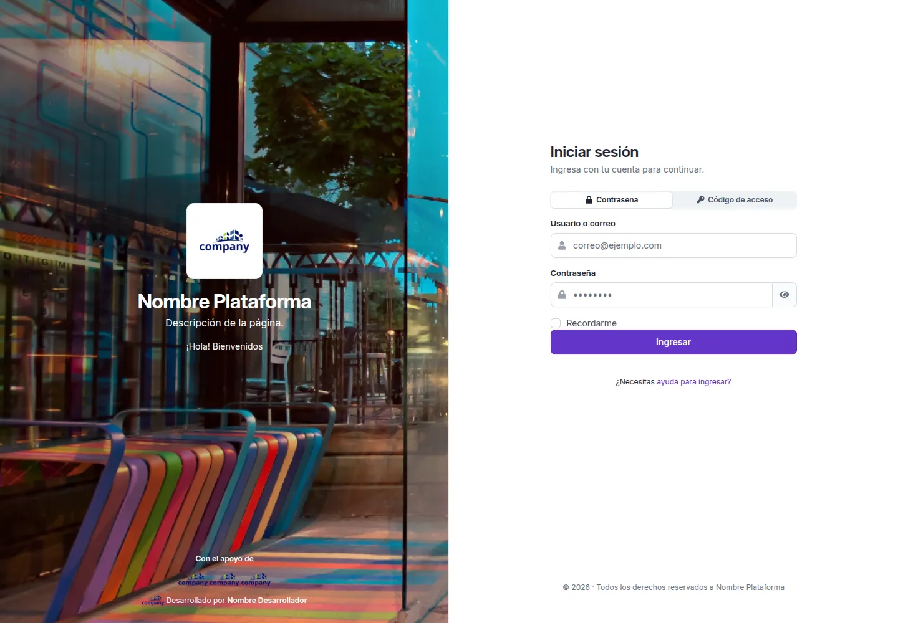

# Tu cuenta

Este manual explica las pantallas que puedes usar con tu cuenta. Solo ves los capítulos de lo que tienes permitido:
si tu cuenta cambia de tipo, el manual cambia con ella. Dentro de cada pantalla pasa lo mismo: si una acción que
nombra el manual no te aparece, tu tipo de usuario no la tiene.

## Entrar y salir

1. En la pantalla de acceso, elige cómo entrar:
    - **«Contraseña»**: escribe tu usuario o tu correo y tu contraseña, y pulsa **«Ingresar»**.
    - **«Código de acceso»**: escribe tu usuario o tu correo y pulsa **«Enviar código»**. Te llega un código de seis
      cifras al correo; escríbelo (o pégalo entero) en las seis casillas y pulsa **«Verificar e ingresar»**. El código
      vence a los pocos minutos (la pantalla dice cuántos); si no te llegó, espera a que se active
      **«Reenviar código»**.
2. Si tu cuenta tiene la verificación en dos pasos, después te pide el código de tu aplicación.
3. Si algo falla, el aviso sale dentro del formulario y el campo con el problema queda marcado: corrígelo y vuelve
   a intentarlo.
4. Para salir, abre el menú de tu nombre, arriba a la derecha, y elige **«Cerrar sesión»**.

!!! tip "Si no puedes entrar"
    En la pantalla de acceso, el enlace de ayuda te deja recuperar la contraseña o el usuario, o avisar de otro
    problema.

## Tamaño de letra y modo de color

- **El modo de color**: abre el menú de tu nombre, arriba a la derecha, y elige en **«Modo de color»**: **«Claro»**,
  **«Oscuro»** o **«Sistema»** (el de tu dispositivo).
- **El tamaño de letra**: en ese mismo menú, **«Preferencias»** te lleva a la pestaña **«Preferencias»** de
  **«Mi cuenta»**. En **«Tamaño de letra»**, elige **«Normal»**, **«Grande»** o **«Más grande»**.

Los dos se aplican al momento y se guardan en tu cuenta. Mientras no elijas, ves lo que haya elegido quien administra
el sitio.

## La ayuda

El icono de interrogación de la barra superior abre el **centro de ayuda**: este manual y, si tu organización lo
tiene configurado, el formulario para **contactar a soporte**.
