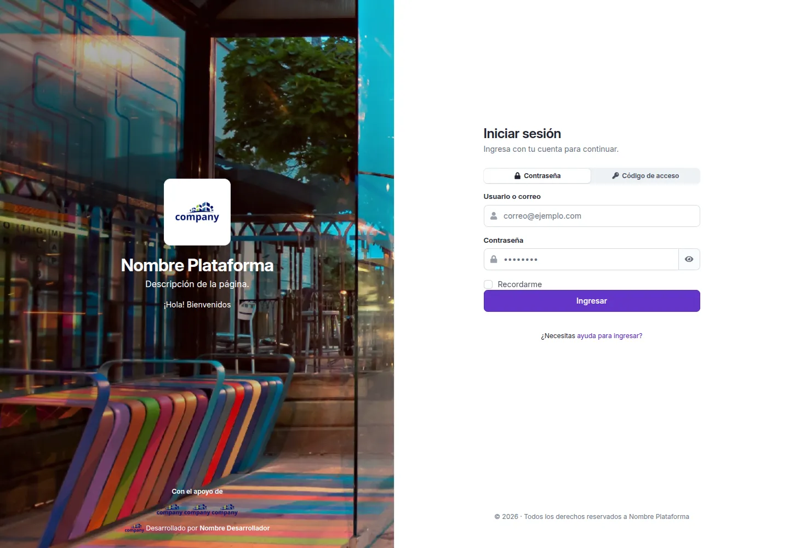

# Tu cuenta

Este manual explica las pantallas que puedes usar con tu cuenta. Solo ves los capítulos de lo que tienes permitido:
si tu cuenta cambia de tipo, el manual cambia con ella. Dentro de cada pantalla pasa lo mismo: si una acción que
nombra el manual no te aparece, tu tipo de usuario no la tiene.

## Entrar y salir

1. En la pantalla de acceso, elige cómo entrar:
    - **«Contraseña»**: escribe tu usuario o tu correo y tu contraseña, y pulsa **«Ingresar»**.
    - **«Código de acceso»**: escribe tu usuario o tu correo y pulsa **«Enviar código»**. Te llega un código de seis
      cifras al correo; escríbelo (o pégalo entero) en las seis casillas y pulsa **«Verificar e ingresar»**. El código
      vence a los pocos minutos (la pantalla dice cuántos); si no te llegó, espera a que se active
      **«Reenviar código»**.
2. Si tu cuenta tiene la verificación en dos pasos, después te pide el código de tu aplicación.
3. Si algo falla, el aviso sale dentro del formulario y el campo con el problema queda marcado: corrígelo y vuelve
   a intentarlo.
4. Para salir, abre el menú de tu nombre, arriba a la derecha, y elige **«Cerrar sesión»**.

!!! tip "Si no puedes entrar"
    En la pantalla de acceso, el enlace de ayuda te deja recuperar la contraseña o el usuario, o avisar de otro
    problema.

## Tus preferencias

En el menú de tu nombre, arriba a la derecha, **«Preferencias»** te lleva a la pestaña **«Preferencias»** de **«Mi
cuenta»**. Tiene dos secciones:

- **Apariencia**: el **modo de color**, **«Claro»**, **«Oscuro»** o **«Sistema»** (el de tu dispositivo). También lo
  tienes en el menú de tu nombre, en **«Modo de color»**, para cambiarlo rápido.
- **Accesibilidad**:
  - **Tamaño de letra**: **«Normal»**, **«Grande»** o **«Más grande»**.
  - **Contraste**: **«Automático»** (sigue a tu dispositivo) o **«Más contraste»**, con textos y colores más marcados.
  - **Movimiento**: **«Automático»** (sigue a tu dispositivo) o **«Reducir movimiento»**, con menos animaciones.
  - **Foco**: **«Normal»** o **«Reforzado»**, con un contorno más visible en lo que tienes seleccionado al moverte con
    el teclado.

Todo se aplica al momento y se guarda en tu cuenta. Cada grupo tiene además **«Como el sitio»**, que sigue lo que haya
elegido quien administra y dice al lado cuál es (por ejemplo, «Como el sitio: Más contraste»). Es lo que tienes mientras
no elijas otra cosa, y elegirla deshace tu elección.

## El buscador

En la barra superior, **«Buscar funcionalidad…»** (o **Ctrl K**) busca entre lo que tú puedes abrir: las pantallas de
los módulos, la configuración, tu cuenta y, en **«Manual»**, los capítulos y las secciones de este manual que te tocan.
Escribe parte del nombre; no distingue mayúsculas ni tildes. Si nada coincide, dice **«Sin resultados»**.

## La ayuda

El icono de interrogación de la barra superior abre el **centro de ayuda**: este manual y, si tu organización lo
tiene configurado, el formulario para **contactar a soporte**.

## El asistente

Si quien administra lo ha encendido para ti, junto a la campana de notificaciones tienes el botón del **asistente**. En
el móvil está en el menú de tu nombre. Abre una ventana donde le preguntas en lenguaje normal sobre la plataforma: dónde
se hace algo («¿Dónde creo un usuario nuevo?»), dónde lo explica este manual («¿Dónde está el manual de
publicaciones?») o lo que tienes pendiente («¿Tengo notificaciones sin leer?»).

- Responde **solo con lo que tú puedes ver** en la plataforma, y debajo de la respuesta te deja botones para ir a las
  pantallas o a los capítulos del manual que nombra.
- **Solo atiende lo de la plataforma.** Si le preguntas otra cosa, te dice que no puede y te ofrece lo que sí sabe hacer.
- **Enter** envía; **Mayús+Enter** salta de línea. Cada pregunta, como mucho 1.000 caracteres.
- **La conversación se conserva** aunque cambies de pantalla o cierres el navegador, en ese mismo equipo y solo para ti.
  Se borra sola tras un rato sin usar el chat (una hora, salvo que quien administra ponga otro tiempo), al salir de tu
  sesión y con **«Nueva conversación»**, arriba en la ventana. **Esc** o la **×** la cierran sin borrarla.
- Si el asistente llegó a su límite de uso, la ventana te lo dice: cuándo se renueva o, si el límite no se renueva solo,
  que quien administra puede reiniciarlo. Si no está disponible para ti, el botón no aparece.

