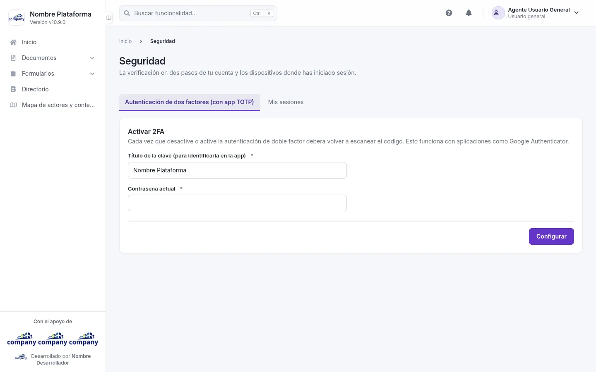

# Tu perfil

Todo lo de tu cuenta está en el menú de tu nombre, arriba a la derecha.

## Tus datos

Elige **«Editar Cuenta»**: tu cuenta se abre en un panel lateral. Cambia lo que necesites y guarda.

## Tu contraseña

Elige **«Cambiar contraseña»**. Para cambiarla, el sistema te pide primero la contraseña actual.

## La seguridad de tu cuenta
<!-- ve: my-space-admin-user-security -->

En el menú de tu usuario, elige **«Seguridad»**: a su lado ves si tu verificación en dos pasos está **«Activa»** o
**«Inactiva»**. Se abre la pantalla **«Seguridad»** en la pestaña de la verificación en dos pasos. En la pestaña
**«Mis sesiones»** ves las sesiones abiertas con tu cuenta. En cada una puedes **«Cerrar»** la que no reconozcas o **«Extender»** la tuya, y **«Cerrar las demás sesiones»** las cierra todas menos la que estás usando.

