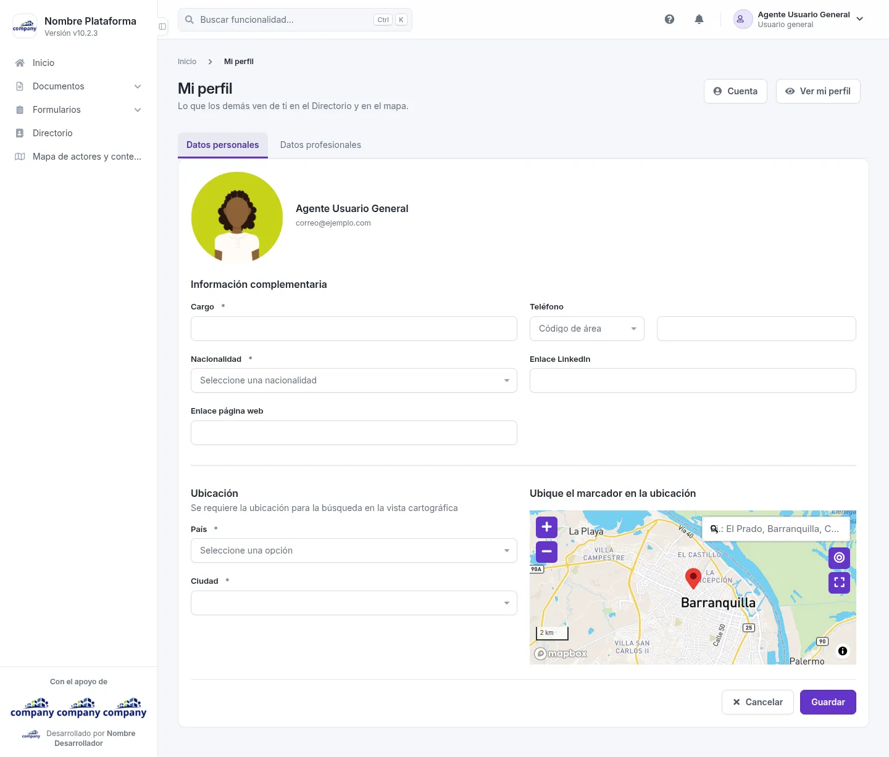

# Mi perfil

Lo que los demás ven de ti en el Directorio y en el mapa. Solo aparece si tu tipo de cuenta tiene perfil.

## Cómo se llega

Elige **«Mi perfil»** en el menú de tu nombre, arriba a la derecha. Arriba, las migas dicen **Inicio › Mi perfil**.

## Qué se ve

El formulario tiene dos pestañas: **«Datos personales»** y **«Datos profesionales»**. Entre los campos obligatorios están **Cargo**, **Nacionalidad** y **País**. Hay también un mapa donde marcas tu ubicación.

## Qué se puede hacer

- **«Cuenta»**: vuelve a los datos de tu cuenta.
- **«Ver mi perfil»**: abre tu ficha como la ven los demás.
- **«Guardar»** o **«Cancelar»**.
