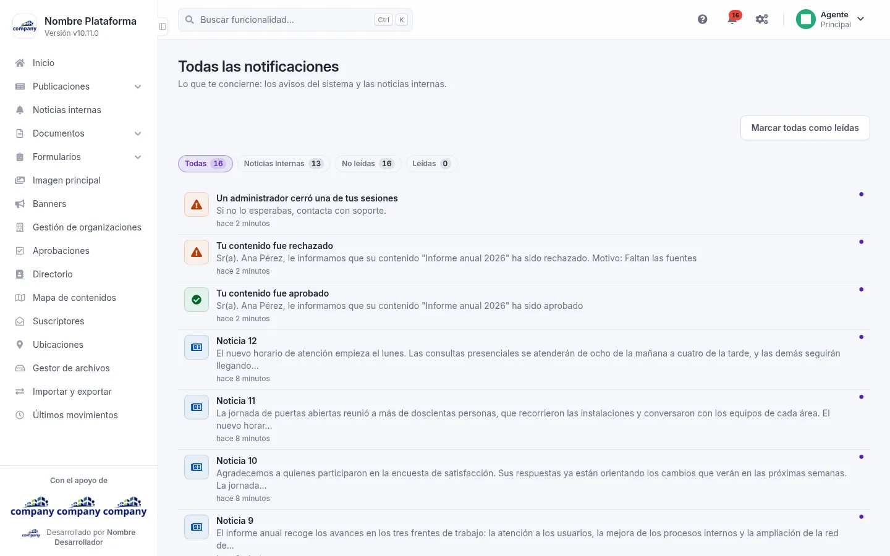

# Notificaciones

La campana de la barra superior reúne lo que te concierne: los avisos que el sistema te manda a ti y las noticias
internas que te llegan.

## La campana
<!-- ve: notifications-view -->

Cómo se llega: el icono de la **campana**, arriba a la derecha. El número sobre ella son las notificaciones que aún no
has leído; si no hay ninguna, no aparece.

Al pulsarla se abre una ventana con:

- cuatro filtros, cada uno con su número: **«Todas»**, **«Noticias internas»**, **«No leídas»** y **«Leídas»**
  («Noticias internas» solo aparece si el sitio usa noticias);
- la lista, de la más nueva a la más antigua. Cada notificación lleva un icono según su tipo (información, éxito,
  advertencia o error), su título, su texto y cuándo llegó. Las que no has leído se distinguen de las leídas;
- **«Marcar todas como leídas»**, arriba, cuando hay alguna sin leer;
- abajo, **«Cargar más»** si hay más, y **«Ver todas»**, que abre la pantalla con la lista completa.

Al pulsar una notificación se marca como leída y, si lleva a algún sitio, te lleva allí. Una noticia interna se abre en
una ventana con su contenido.

## Todas las notificaciones
<!-- ve: notifications-view -->

Cómo se llega: **«Ver todas»**, al pie de la campana.

La misma lista a página entera, con los cuatro filtros y **«Marcar todas como leídas»**. Si hay más, al final
**«Cargar más»** trae las siguientes.

Las que ya has leído se borran cuando te llega una nueva, si tienen más de 90 días. Las que no has leído se quedan
hasta que las leas.
