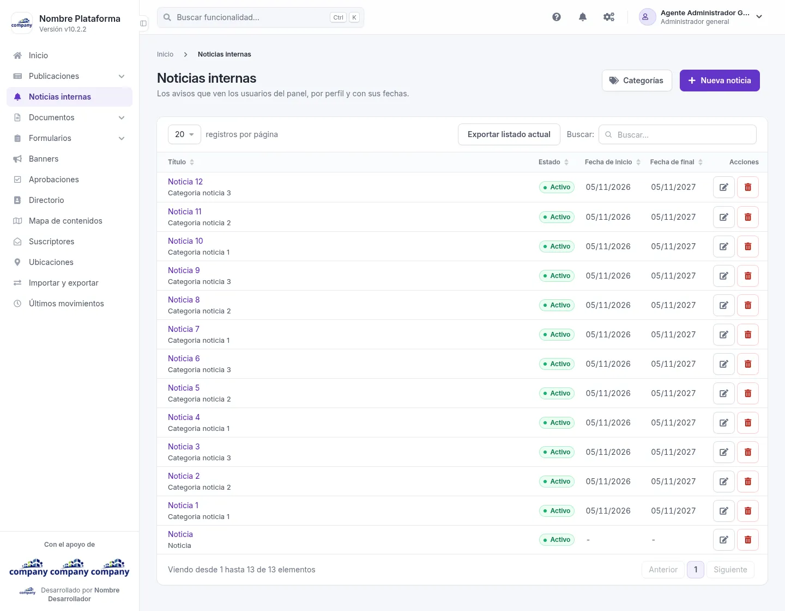
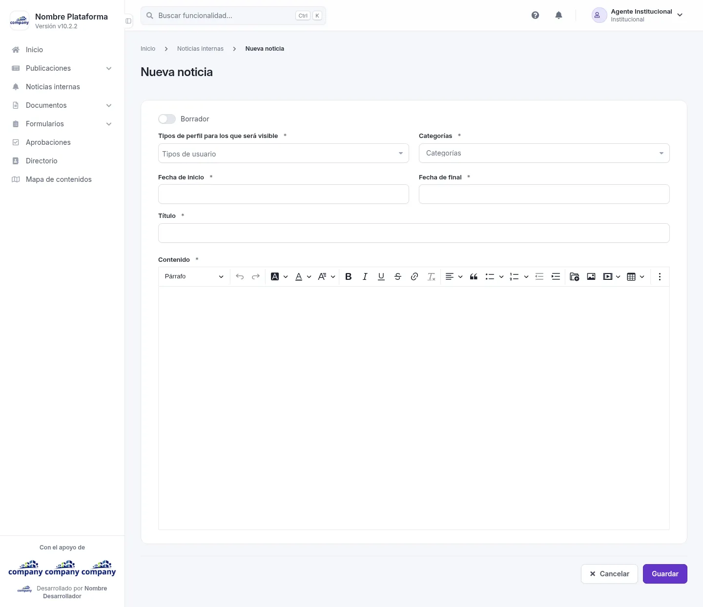
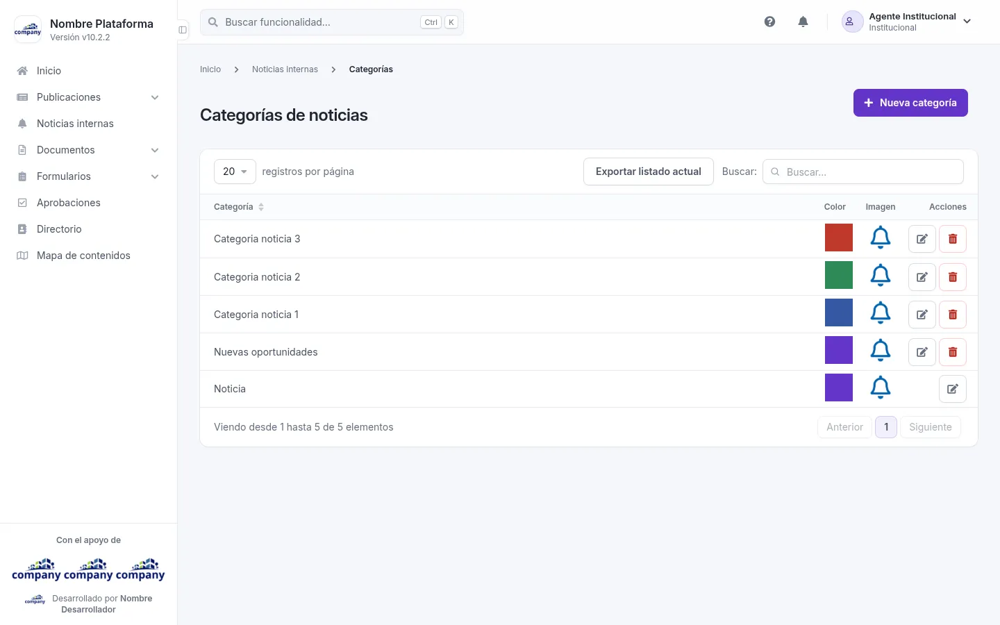

# Noticias internas

Los avisos que ven los usuarios del panel, por perfil y con sus fechas.

## El listado de noticias

Cómo se llega: **«Noticias internas»**, en el menú lateral.

La tabla muestra: **Título**, **Estado**, **Fecha de inicio**, **Fecha de final** y **Acciones**. En cada fila puedes **«Editar»** o **«Eliminar»** la noticia.

Arriba están los botones **«Nueva noticia»**, **«Categorías»** y **«Exportar listado actual»**.

## Agregar y editar una noticia

Cómo se llega: pulsa **«Nueva noticia»**, o **«Editar»** en la fila de una noticia.

| Campo | Obligatorio | Para qué |
| --- | --- | --- |
| Borrador | No | Márcala si todavía no está lista. |
| Tipos de perfil para los que será visible | Sí | Los tipos de usuario que verán la noticia. |
| Categorías | Sí | La categoría de la noticia. |
| Fecha de inicio | Sí | Desde cuándo se muestra. |
| Fecha de final | Sí | Hasta cuándo se muestra. |
| Título | Sí | El título de la noticia. |
| Contenido | Sí | El texto, con un editor que tiene negrita, cursiva, listas, enlaces, imágenes y tablas. |

Botones: **«Guardar»**, **«Cancelar»** (vuelve al listado) y, al editar, **«Eliminar»**.

## Las categorías de noticias

Cómo se llega: botón **«Categorías»** del listado de noticias.

La tabla muestra: **Categoría**, **Color**, **Imagen** y **Acciones**. En cada fila puedes **«Editar»** o **«Eliminar»**. Arriba están **«Nueva categoría»** y **«Exportar listado actual»**.

### Agregar y editar una categoría

| Campo | Obligatorio | Para qué |
| --- | --- | --- |
| Nombre | Sí | El nombre de la categoría. |
| Color | Sí | El color de la categoría; el botón **«Elegir color»** te deja escogerlo. |

Con **«Cambiar imagen»** eliges el ícono de la categoría: al crearla es obligatorio. Al editar, **«Descargar / ver»** abre el actual. Botones: **«Guardar»**, **«Cancelar»** y, al editar, **«Eliminar»**.

Al editar, el selector **«Idiomas»** elige en qué idioma escribes.
