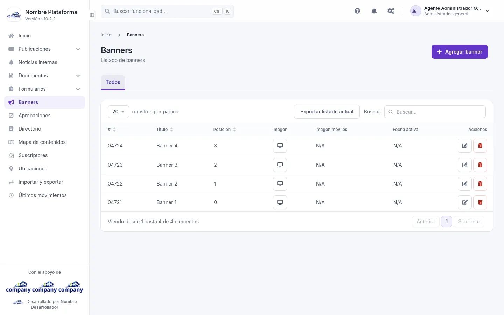
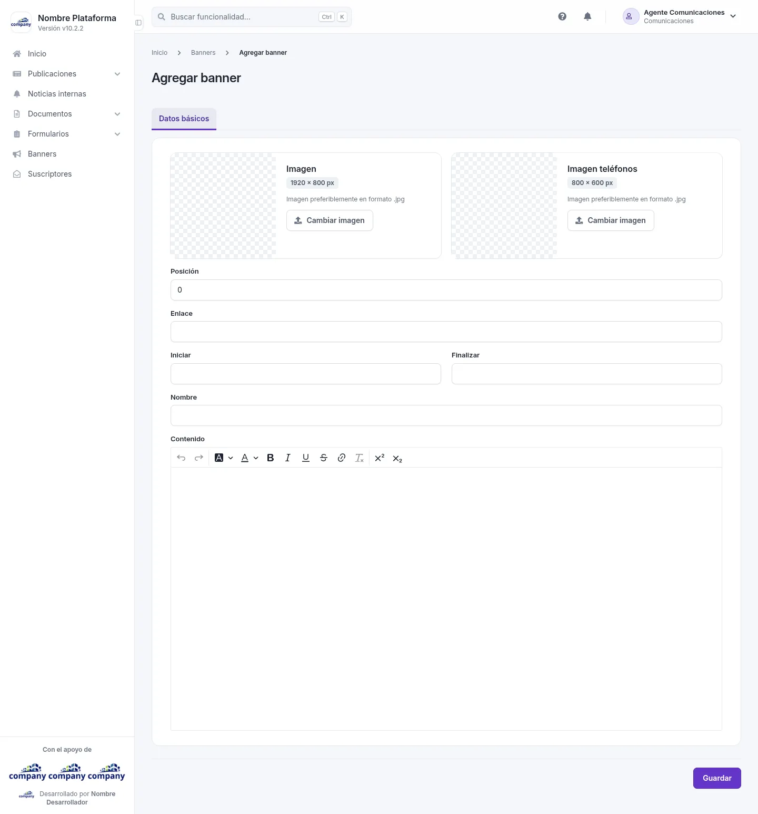
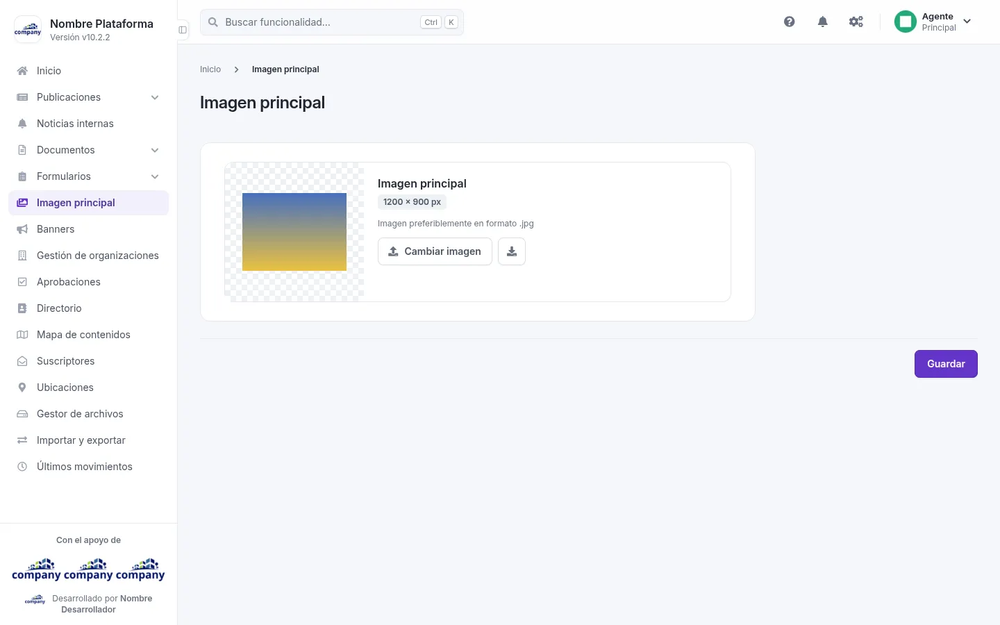

# Banners e imagen principal

Aquí gestionas los banners y la imagen principal del sitio.

## El listado de banners

Cómo se llega: **«Banners»**, en el menú lateral.

Una pestaña, **«Todos»**. La tabla muestra: **#**, **Título**, **Posición**, **Imagen**, **Imagen móviles**, **Fecha activa** y **Acciones**.

En cada fila puedes:

- **«Ver la imagen de escritorio»**.
- **«Editar»** el banner.
- **«Eliminar»** el banner.

Arriba están **«Agregar banner»** y **«Exportar listado actual»**.

## Agregar y editar un banner

Cómo se llega: pulsa **«Agregar banner»**, o **«Editar»** en la fila de un banner.

| Campo | Obligatorio | Para qué |
| --- | --- | --- |
| Posición | No | El orden del banner. |
| Enlace | No | A dónde lleva el banner. |
| Iniciar | No | Desde cuándo está activo. |
| Finalizar | No | Hasta cuándo está activo. |
| Nombre | No | El nombre del banner. |
| Contenido | No | El texto del banner, con un editor que tiene negrita, cursiva, subrayado, enlaces y colores. |

Hay dos imágenes, cada una con su **«Cambiar imagen»**: **Imagen** (obligatoria al crear), la de escritorio, e **Imagen teléfonos**, la de los móviles. Al editar, **«Descargar / ver»** abre la imagen actual.

Botones: **«Guardar»** y, al editar, **«Eliminar»**.

Al editar, el selector **«Idiomas»** elige en qué idioma escribes.

## La imagen principal

Cómo se llega: **«Imagen principal»**, en el menú lateral.

La pantalla muestra la imagen actual. Con **«Cambiar imagen»** eliges otra, con **«Descargar / ver»** abres la actual y con **«Guardar»** confirmas el cambio.
