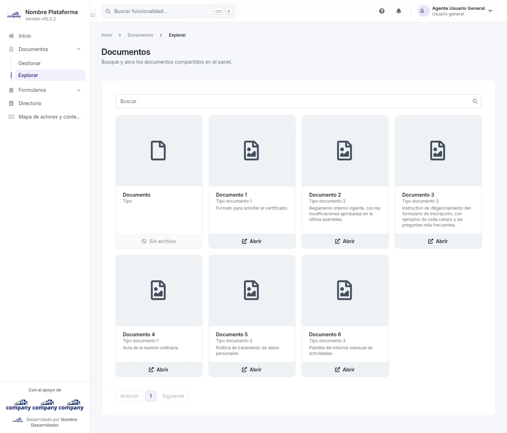
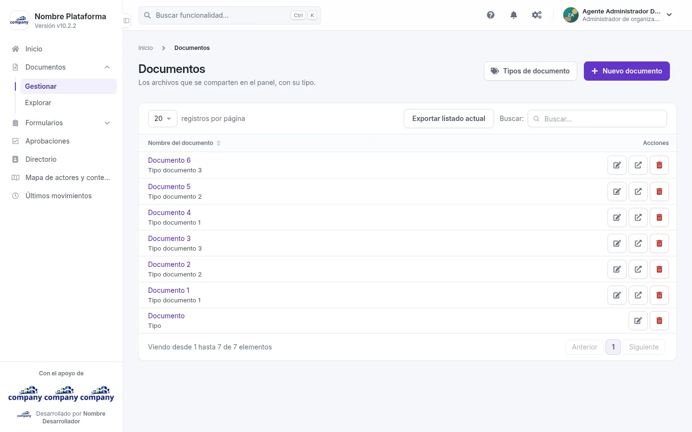
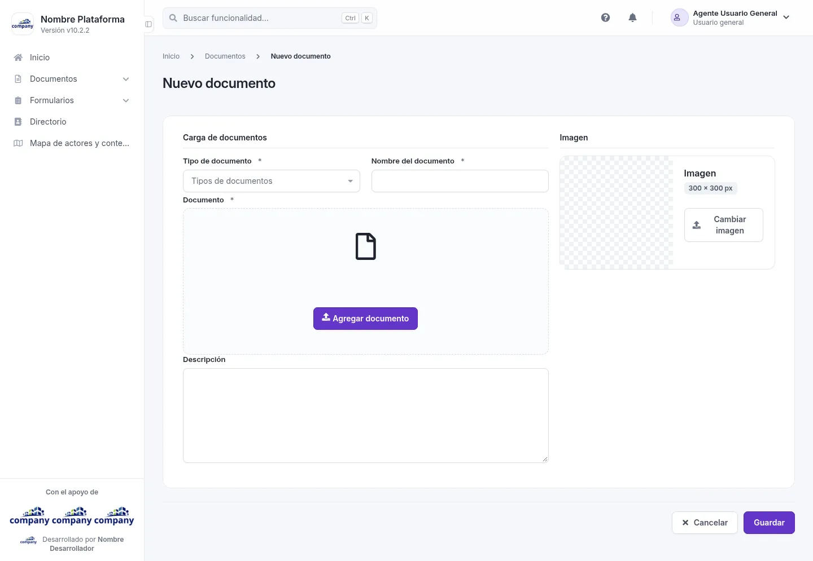
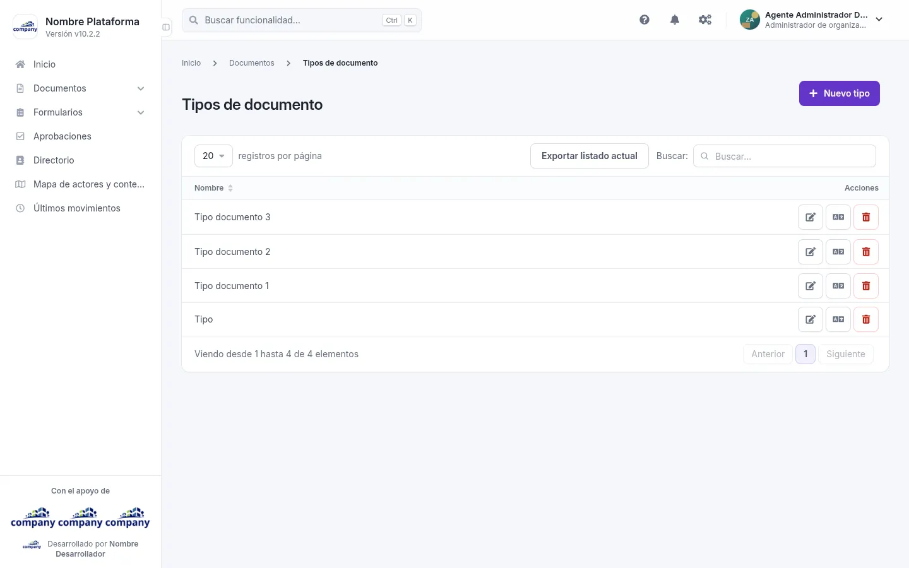

# Documentos

Los archivos que se comparten en el panel, con su tipo.

## Explorar los documentos

Cómo se llega: **«Documentos» › «Explorar»**, en el menú lateral.

Es para buscar y abrir los documentos compartidos. Cada documento aparece en una tarjeta con su nombre, su tipo y su descripción. Arriba hay un cuadro **«Buscar»** y abajo, la paginación.

En cada tarjeta, **«Abrir»** muestra el archivo. Si el documento no tiene archivo, la tarjeta dice **«Sin archivo»**.

## Gestionar los documentos

Cómo se llega: **«Documentos» › «Gestionar»**, en el menú lateral.

La tabla muestra el **Nombre del documento** y sus **Acciones**. En cada fila puedes **«Editar»**, **«Ver el archivo»** o **«Eliminar»**.

Arriba están **«Tipos de documento»**, **«Nuevo documento»** y **«Exportar listado actual»**.

## Agregar y editar un documento

Cómo se llega: pulsa **«Nuevo documento»**, o **«Editar»** en la fila de un documento.

| Campo | Obligatorio | Para qué |
| --- | --- | --- |
| Tipo de documento | Sí | El tipo con que se clasifica. |
| Nombre del documento | Sí | El nombre con el que se ve en el listado. |
| Documento | Sí | El archivo. |
| Descripción | No | Un texto que explica el documento. |

Con **«Cambiar imagen»** eliges la imagen del documento.

Botones: **«Guardar»** y **«Cancelar»**. Al crear, el archivo se elige con **«Agregar documento»**. Al editar tienes además **«Ver documento»**, **«Cambiar documento»** y **«Eliminar»**.

## Tipos de documento

Cómo se llega: botón **«Tipos de documento»** del listado de documentos.

La tabla muestra el **Nombre** de cada tipo. En cada fila puedes **«Editar»**, **«Traducir»** o **«Eliminar»**. Arriba están **«Nuevo tipo»** y **«Exportar listado actual»**.

### Agregar y editar un tipo

Pulsa **«Nuevo tipo»**, o **«Editar»** en la fila de un tipo; **«Traducir»** abre el mismo formulario para escribir el nombre en inglés. Al editar, el selector **«Idiomas»** elige en qué idioma escribes.

| Campo | Obligatorio | Para qué |
| --- | --- | --- |
| Nombre | Sí | El nombre del tipo. |

Botones: **«Guardar»**, **«Cancelar»** y, al editar, **«Eliminar»**.
