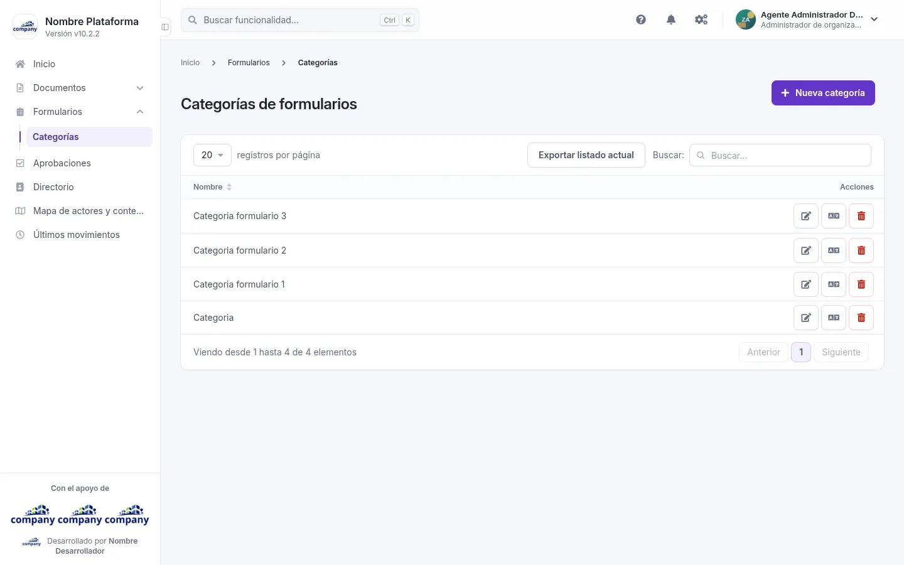
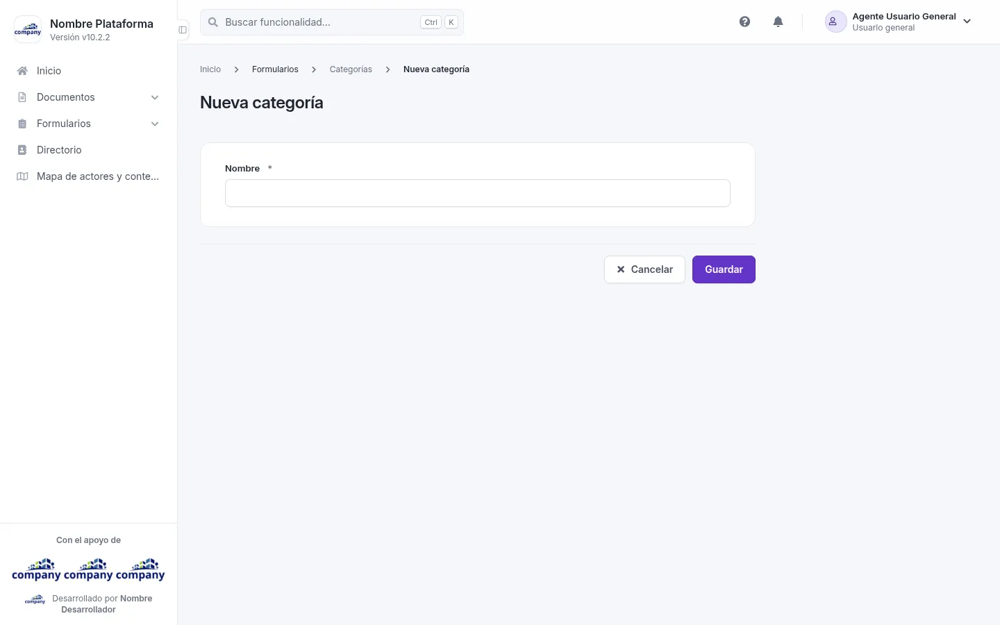

# Formularios

Esta sección reúne las categorías de formularios.

## Categorías de formularios
<!-- ve: categories-admin-list -->

Cómo se llega: **«Formularios» › «Categorías»**, en el menú lateral.

La tabla muestra el **Nombre** de cada categoría. En cada fila puedes **«Editar»**, **«Traducir»** o **«Eliminar»**. Arriba están **«Nueva categoría»** y **«Exportar listado actual»**.

## Agregar y editar una categoría
<!-- ve: categories-admin-forms-add, categories-admin-forms-edit -->

Pulsa **«Nueva categoría»**, o **«Editar»** en la fila de una categoría; **«Traducir»** abre el mismo formulario para escribir el nombre en inglés. Al editar, el selector **«Idiomas»** elige en qué idioma escribes.

| Campo | Obligatorio | Para qué |
| --- | --- | --- |
| Nombre | Sí | El nombre de la categoría. |

Botones: **«Guardar»**, **«Cancelar»** y, al editar, **«Eliminar»**.
