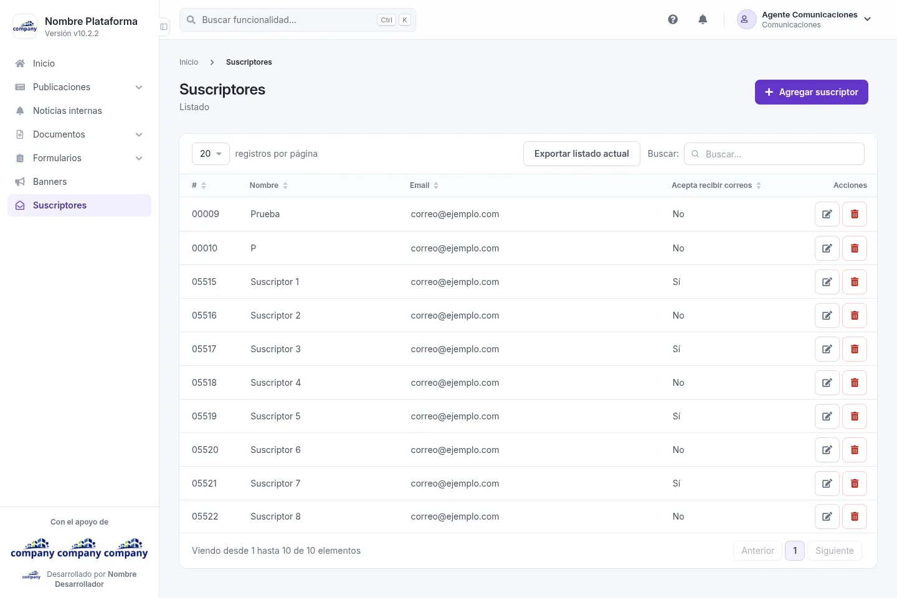
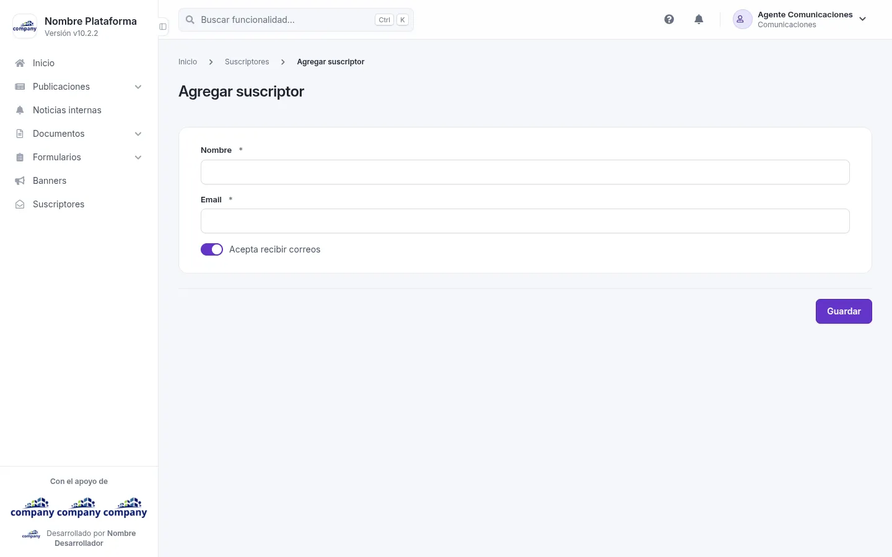

# Suscriptores

La lista de personas suscritas.

## El listado de suscriptores

Cómo se llega: **«Suscriptores»**, en el menú lateral.

La tabla muestra: **#**, **Nombre**, **Email**, **Acepta recibir correos** y **Acciones**. En cada fila puedes **«Editar»** o **«Eliminar»**.

Arriba están **«Agregar suscriptor»** y **«Exportar listado actual»**.

## Agregar y editar un suscriptor

Cómo se llega: pulsa **«Agregar suscriptor»**, o **«Editar»** en la fila de un suscriptor.

| Campo | Obligatorio | Para qué |
| --- | --- | --- |
| Nombre | Sí | El nombre del suscriptor. |
| Email | Sí | Su correo electrónico. |
| Acepta recibir correos | No | Márcalo si la persona acepta recibir correos. |

Botones: **«Guardar»** y, al editar, **«Eliminar»**.
