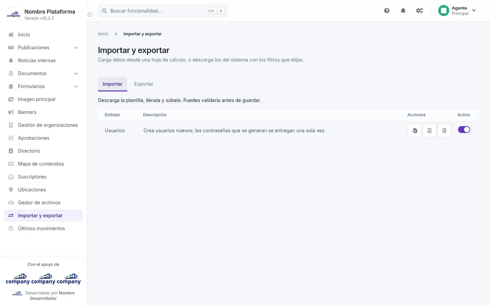
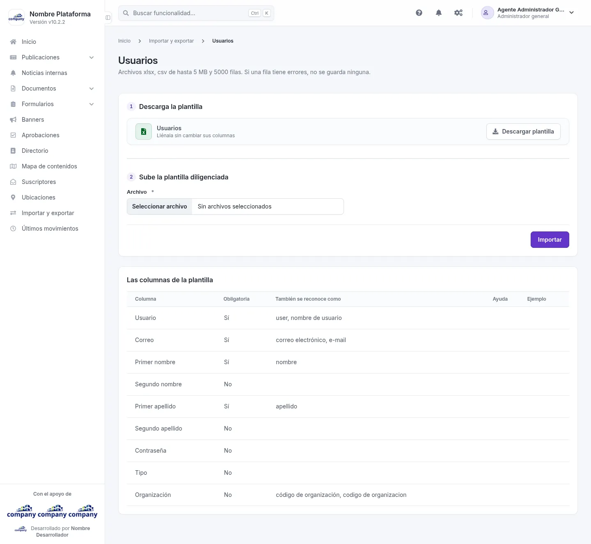
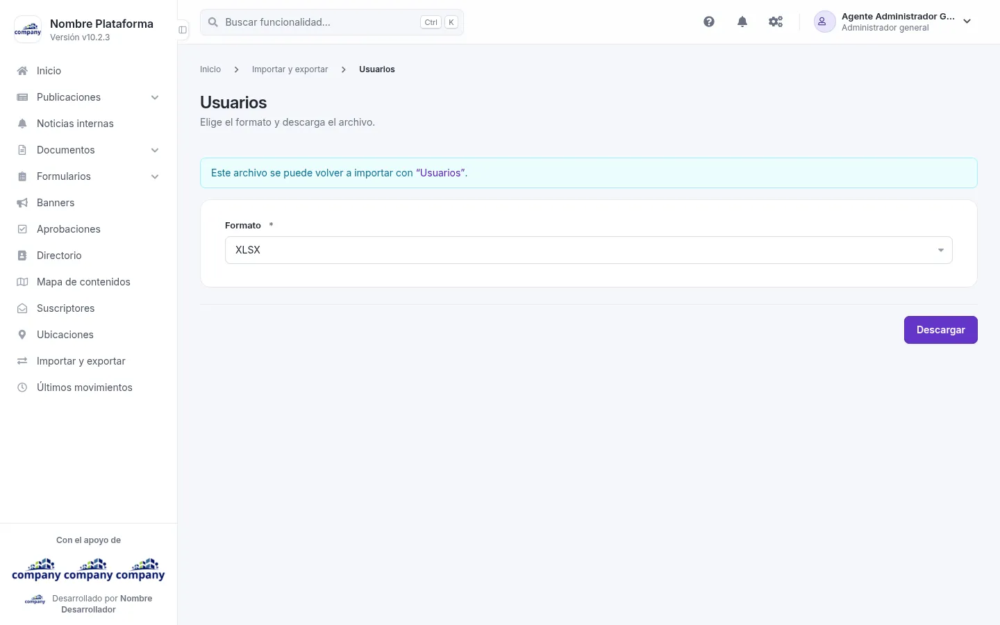

# Importar y exportar

Carga datos desde una hoja de cálculo, o descarga los del sistema en el formato que elijas.

## La pantalla principal

Cómo se llega: **«Importar y exportar»**, en el menú lateral.

Tiene dos pestañas:

- **«Importar»**: una tabla con **Entidad**, **Descripción**, **Acciones** y **Activo**. En cada fila puedes **«Importar»**, o descargar la plantilla en **«Plantilla XLSX»** o **«Plantilla CSV»**.
- **«Exportar»**: la misma tabla. En cada fila puedes **«Exportar»**, o descargar en **«Descargar XLSX»** o **«Descargar CSV»**.

## Importar usuarios

Cómo se llega: en la pestaña **«Importar»**, pulsa **«Importar»** en la fila de usuarios; o por el botón de engranajes de la barra superior, **«Configuración del sistema» › «Gestión de usuarios» › «Importar usuarios»**.

El sistema acepta archivos xlsx o csv de hasta 5 MB y 5000 filas.

!!! warning "Todo o nada"
    Si una fila tiene errores, no se guarda ninguna.

Son dos pasos:

1. **Descarga la plantilla**: pulsa **«Descargar plantilla»** y llénala sin cambiar sus columnas.
2. **Sube la plantilla diligenciada**: elige el **Archivo** (obligatorio) y pulsa **«Importar»**.

Las columnas de la plantilla:

| Columna | Obligatoria | También se reconoce como |
| --- | --- | --- |
| Usuario | Sí | user, nombre de usuario |
| Correo | Sí | correo electrónico, e-mail |
| Primer nombre | Sí | nombre |
| Segundo nombre | No | |
| Primer apellido | Sí | apellido |
| Segundo apellido | No | |
| Contraseña | No | |
| Tipo | No | |
| Organización | No | código de organización, codigo de organizacion |

## Exportar usuarios

Cómo se llega: en la pestaña **«Exportar»**, pulsa **«Exportar»** en la fila de usuarios.

Elige el **Formato**, XLSX (el de fábrica) o CSV, y pulsa **«Descargar»**. Los atajos **«Descargar XLSX»** y
**«Descargar CSV»** de la pestaña hacen lo mismo sin pasar por esta pantalla.

El archivo se llama `users-` seguido de la fecha y la hora, y trae una fila por usuario con estas columnas: Usuario,
Correo, Primer nombre, Segundo nombre, Primer apellido, Segundo apellido, Tipo y Organización. Se puede volver a
importar con **«Importar usuarios»**; no lleva contraseñas.
