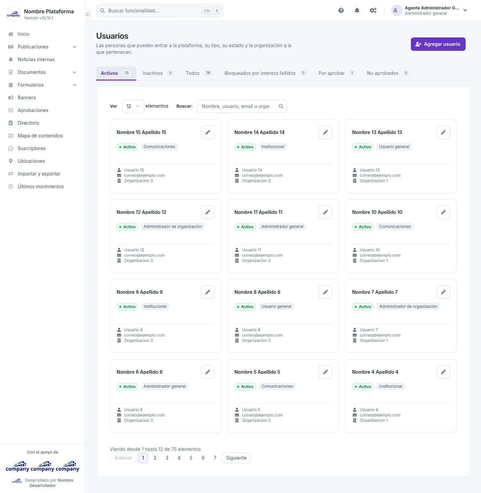
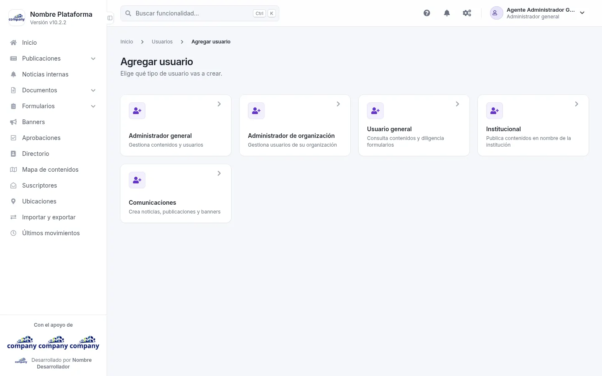
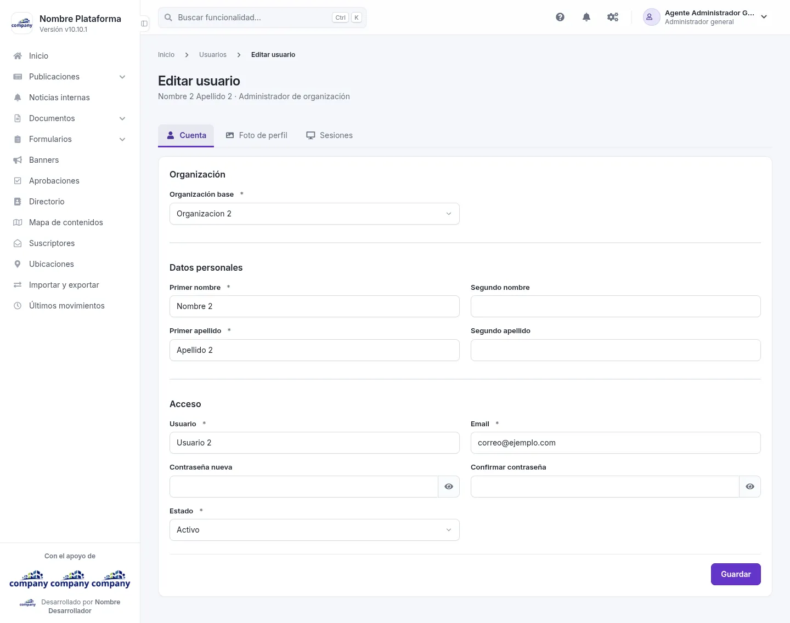

# Usuarios

Aquí ves quién entra al panel, con qué tipo de usuario y en qué estado, y creas o editas cuentas.

## La lista de usuarios
<!-- ve: users-list -->

Se llega por el botón de engranajes de la barra superior: **«Configuración del sistema» › «Gestión de usuarios» › «Gestionar usuarios»**.

La lista se divide en pestañas según el estado de la cuenta:

- **Todos**
- **Activos**
- **Inactivos**
- **Bloqueados por intentos fallidos**
- **Por aprobar**
- **No aprobados**

Cada pestaña muestra las cuentas en tarjetas: nombre, estado (activo o inactivo), tipo, usuario, correo y organización. Arriba eliges cuántas ver en **«Resultados visibles»** y buscas en **«Buscador»**; abajo está la paginación. El botón del lápiz de cada tarjeta, **«Editar»**, abre esa cuenta.

## Agregar un usuario
<!-- ve: users-selection-create, users-form-create -->

Pulsa **«Agregar usuario»**. Primero el sistema te lleva a elegir el tipo de usuario; al elegirlo, se abre el formulario de alta para ese tipo.

## Agregar y editar
<!-- ve: users-form-edit, users-form-create -->

El formulario de alta y el de edición son casi iguales. En la edición, el título muestra el nombre de la persona y su tipo, y aparecen tres pestañas: **Cuenta**, **Foto de perfil** y **Sesiones**. En el alta solo está la pestaña **Cuenta**.

| Campo | Obligatorio | Para qué |
| :-- | :-- | :-- |
| Organización base | Sí | La organización a la que pertenece el usuario |
| Primer nombre | Sí | |
| Segundo nombre | No | |
| Primer apellido | Sí | |
| Segundo apellido | No | |
| Usuario | Sí | El nombre con el que la persona inicia sesión |
| Email | Sí | El correo de la persona |
| Contraseña (en la edición, «Contraseña nueva») | No | La clave de acceso |
| Confirmar contraseña | No | Se repite la clave para evitar errores |
| Estado | Sí | Si la cuenta está activa o no |

Junto a cada campo de contraseña hay un botón **«Mostrar contraseña»** para ver lo que escribes. Cuando termines, pulsa **«Guardar»**.
