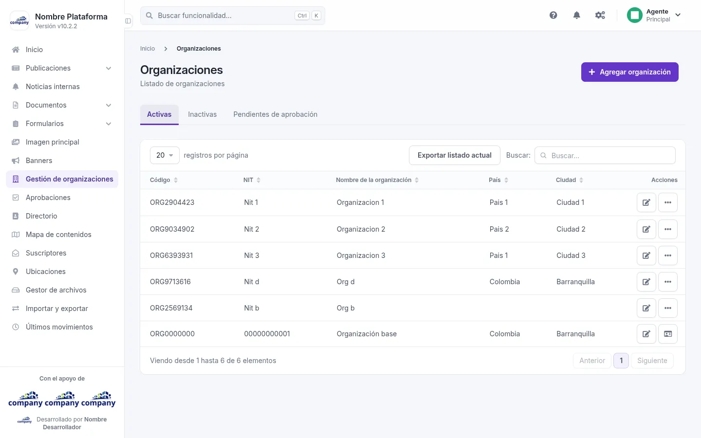
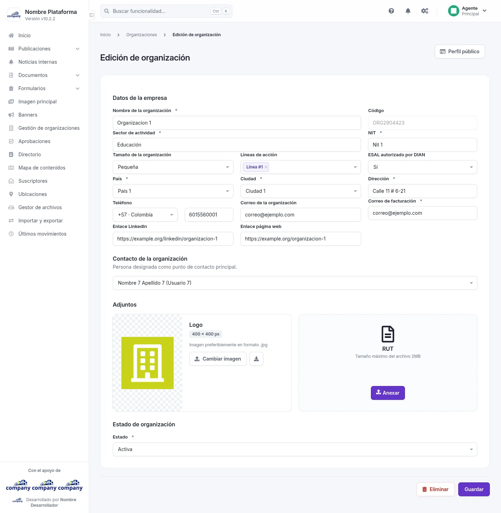

# Organizaciones

Aquí gestionas las organizaciones registradas y lo que se muestra de cada una.

## La lista de organizaciones
<!-- ve: organizations-admin-list -->

Se llega desde el menú lateral: **«Gestión de organizaciones»**.

La lista tiene tres pestañas: **Activas**, **Inactivas** y **Pendientes de aprobación**. La tabla muestra código, NIT, nombre de la organización, ubicación (país o departamento y ciudad) y acciones.

Cada fila ofrece estas acciones:

- **«Editar»**: abre los datos de la cuenta de la organización.
- **«Perfil público»**: abre lo que los demás ven de la organización, para editarlo.
- **«Ver perfil»**: abre la ficha de la organización.
- **«Eliminar»**.

Arriba tienes **«Agregar organización»** y **«Exportar listado actual»**.

## Agregar y editar una organización
<!-- ve: organizations-admin-forms-edit, organizations-admin-forms-add -->

Los dos formularios son casi iguales. La edición añade el botón **«Perfil público»**, el botón **«Eliminar»** y los campos «Código» y «Contacto de la organización».

| Campo | Obligatorio | Para qué |
| :-- | :-- | :-- |
| Nombre de la organización | Sí | |
| Sector de actividad | Sí | |
| Tamaño de la organización | No | |
| Líneas de acción | No | |
| País | Sí | |
| Ciudad | Sí | |
| Correo de la organización | No | |
| Enlace LinkedIn | No | |
| Enlace página web | No | |
| Teléfono | No | El indicativo del país y el número. |
| NIT | Sí | |
| ESAL autorizado por DIAN | No | |
| Dirección | Sí | |
| Correo de facturación | Sí | |
| Contacto de la organización (solo en la edición) | Sí | |
| RUT | Sí al agregar; al editar, no | Un archivo, con **«Anexar»**. Tamaño máximo: 2 MB |
| Estado | Sí | |

También puedes **«Cambiar imagen»** para poner la imagen de la organización. Termina con **«Guardar»**.
