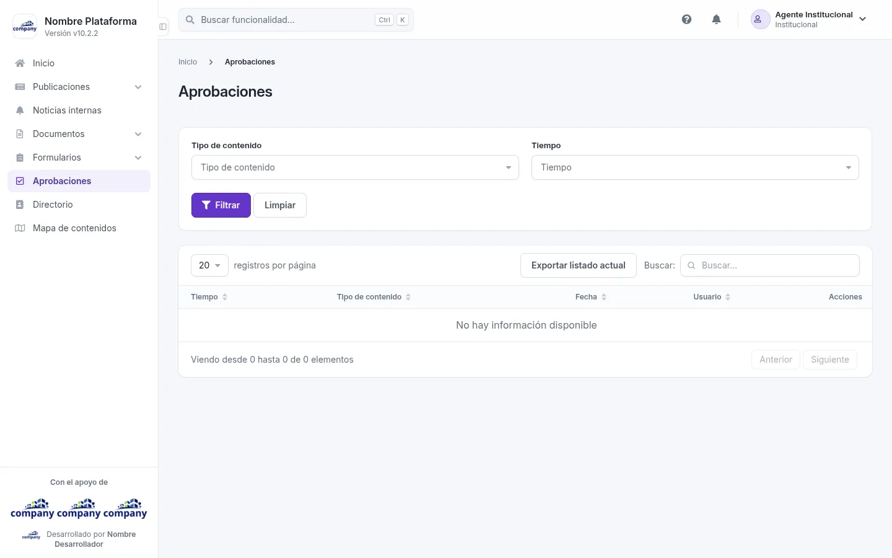
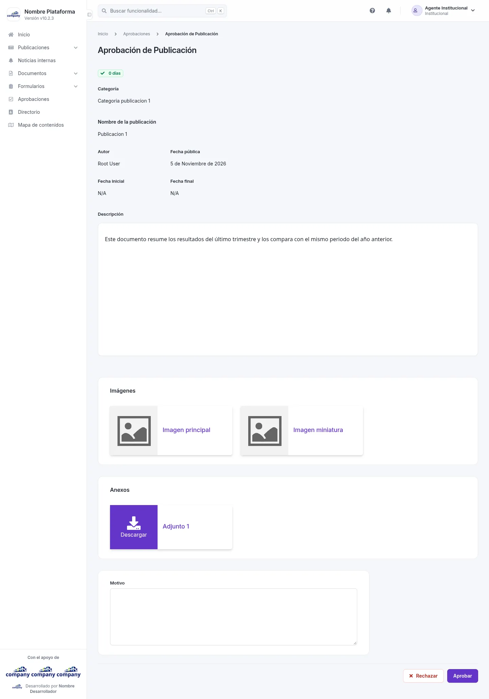

# Aprobaciones

Aquí ves los contenidos que están pendientes de aprobación.

## Cómo se llega

Desde el menú lateral: **«Aprobaciones»**.

## Qué se ve
<!-- ve: system-approval-admin-list -->

Una tabla con estas columnas: **Tiempo**, **Tipo de contenido**, **Fecha**, **Usuario** y **Acciones**. Si no hay nada pendiente, la pantalla dice «No hay información disponible».

## Qué se puede hacer

Para acotar la lista, elige un **Tipo de contenido** y un **Tiempo**, y pulsa **«Filtrar»**. **«Limpiar»** quita los filtros. **«Exportar listado actual»** descarga lo que estás viendo.

## Revisar un contenido
<!-- ve: system-approval-admin-forms-approval -->

Cómo se llega: en la lista, pulsa **«Revisar»** en la fila del contenido.

La pantalla se titula con el tipo de contenido, por ejemplo **«Aprobación de Publicación»**, y enseña lo que hay que
revisar: cuánto lleva esperando, sus datos (en una publicación: categoría, nombre, autor, fechas y descripción), sus
imágenes y sus anexos, que puedes **«Descargar»**.

Abajo, el campo **«Motivo»**, opcional, y dos botones: **«Rechazar»** y **«Aprobar»**. Los dos piden confirmación.
Al confirmar, vuelves a la lista, donde el contenido ya no aparece, y la persona que lo creó recibe un correo con el
resultado.

!!! tip "Qué cambia en el sitio"
    En una publicación, la aprobada se ve en el sitio público y la rechazada no.
