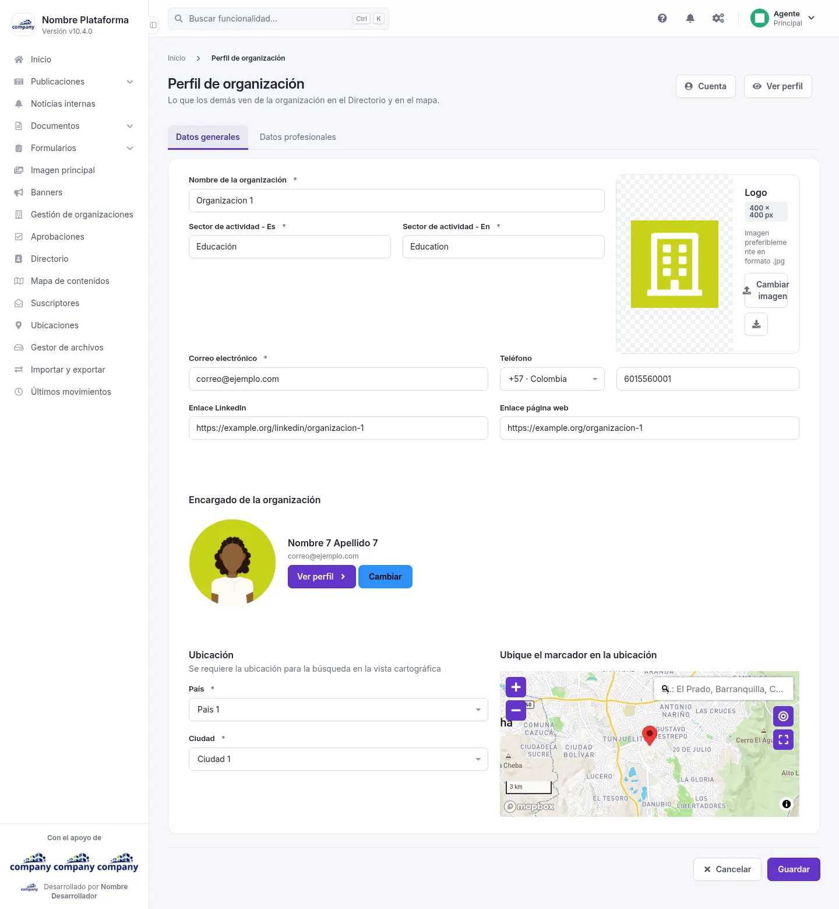

# Tu organización

El perfil público de una organización es lo que los demás ven de ella en el Directorio y en el mapa.

## El perfil público

Se abre con **«Perfil público»**, desde la lista o la edición de una organización; con **«Mi organización»**, en el menú de tu nombre, si tu cuenta lo tiene; o con **«Editar»**, en la ficha de la organización del Directorio. Dice, arriba, que es lo que los demás ven de la organización en el Directorio y en el mapa. Tiene dos pestañas: **Datos generales** y **Datos profesionales**. Si la organización no tiene persona encargada, el perfil no se puede modificar: elige una con **«Cambiar»**.

Desde aquí puedes:

- **«Cuenta»**: vuelve a los datos de la cuenta de la organización.
- **«Ver perfil»**: abre la ficha de la organización.
- **«Cambiar imagen»**.
- **«Guardar»** o **«Cancelar»**.

Campos de la pestaña **Datos generales**:

| Campo | Obligatorio | Para qué |
| :-- | :-- | :-- |
| Nombre de la organización | Sí | |
| Sector de actividad - Es | Sí | El sector, en español |
| Sector de actividad - En | Sí | El sector, en inglés |
| Correo electrónico | Sí | |
| Enlace LinkedIn | No | |
| Enlace página web | No | |
| País | Sí | |
| Ciudad | Sí | |
| Teléfono | No | |

Al final, marca la ubicación en el mapa.

Campos de la pestaña **Datos profesionales**:

| Campo | Obligatorio | Para qué |
| :-- | :-- | :-- |
| Instituciones a las que pertenece actualmente | No | |
| Mostrar el perfil de la organización en el directorio y en el mapa | No | Una casilla para decidir si el perfil se muestra |
