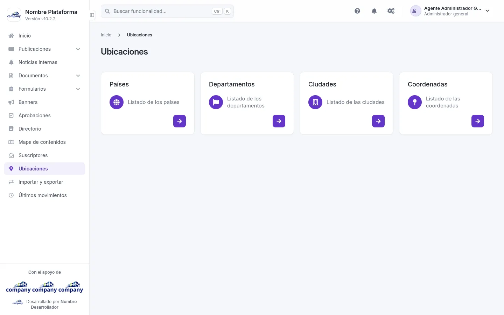
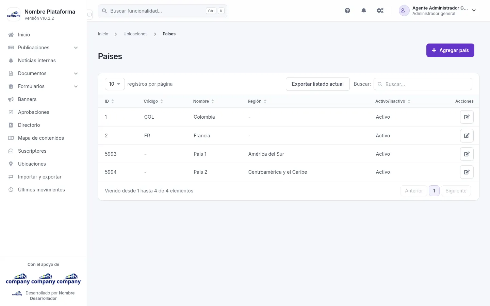
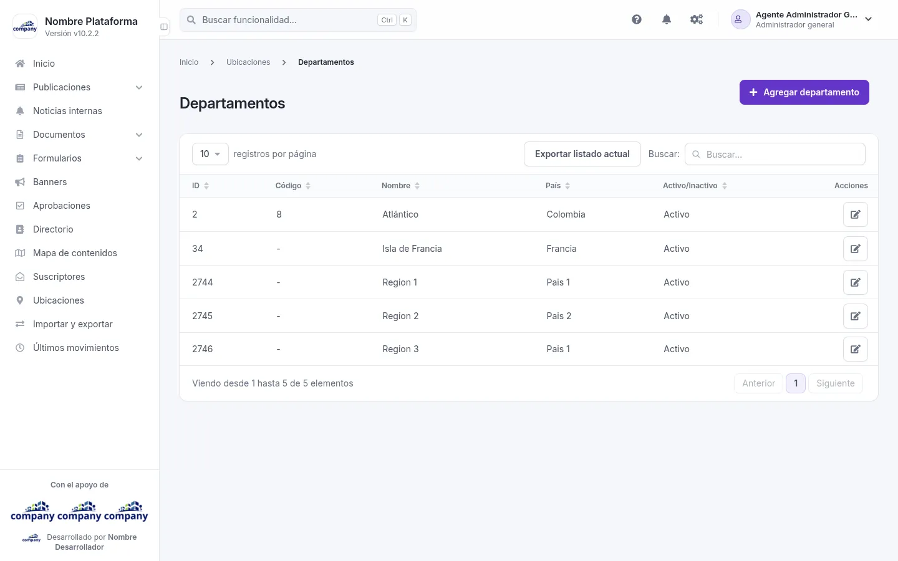
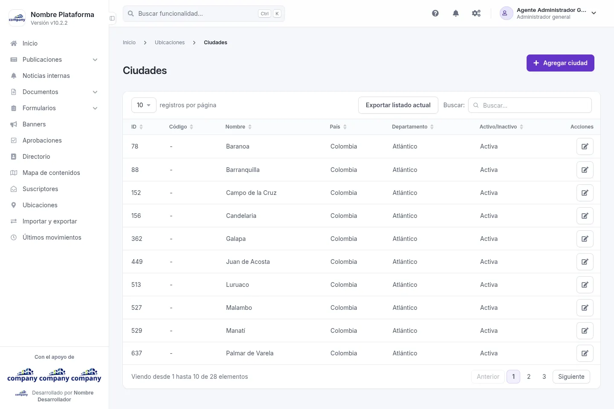
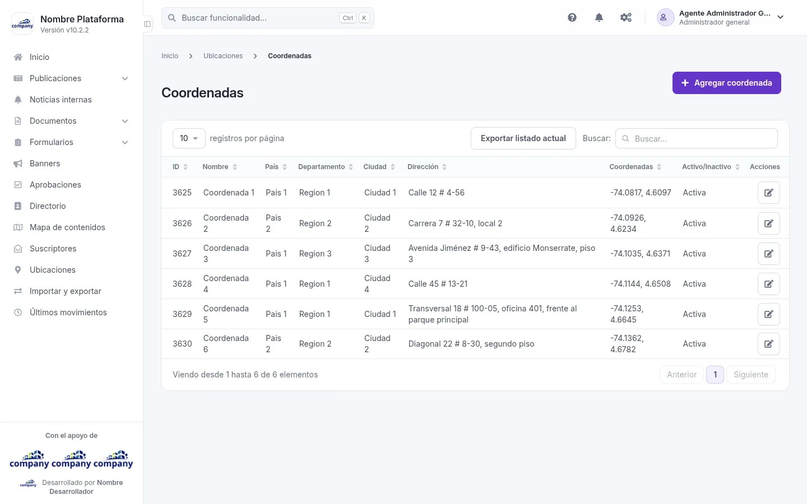
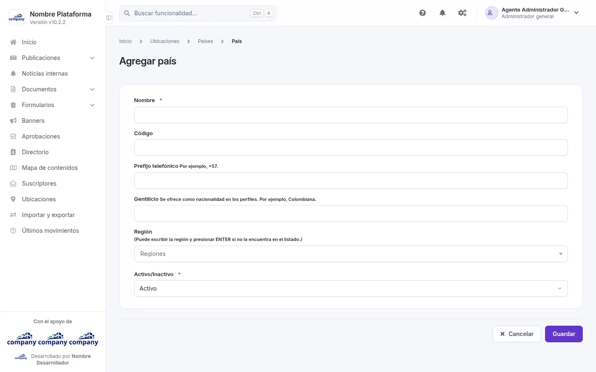

# Ubicaciones

Aquí se mantienen los lugares que usa el resto del panel: países, departamentos, ciudades y coordenadas.

## Cómo se llega

Desde el menú lateral: **«Ubicaciones»**. La pantalla de inicio de la sección ofrece un listado de los países, de los departamentos, de las ciudades y de las coordenadas.

Cada listado tiene la misma forma: una tabla con un botón **«Editar»** por fila, un botón principal para agregar y **«Exportar listado actual»**. En los formularios, **«Cancelar»** vuelve al listado y **«Guardar»** guarda.

## Países

Columnas: ID, código, nombre, región, activo o inactivo y acciones. Para crear uno, pulsa **«Agregar país»**.

| Campo | Obligatorio | Para qué |
| :-- | :-- | :-- |
| Nombre | Sí | |
| Código | No | |
| Prefijo telefónico | No | Por ejemplo, +57 |
| Gentilicio | No | Se ofrece como nacionalidad en los perfiles. Por ejemplo, Colombiana |
| Región | No | Puedes escribir la región y pulsar ENTER si no la encuentras en el listado |
| Activo/Inactivo | Sí | |

## Departamentos

Columnas: ID, código, nombre, país, activo o inactivo y acciones. Para crear uno, pulsa **«Agregar departamento»**.

| Campo | Obligatorio | Para qué |
| :-- | :-- | :-- |
| País | Sí | |
| Nombre | Sí | |
| Código | No | |
| Activo/Inactivo | Sí | |

## Ciudades

Columnas: ID, código, nombre, país, departamento, activo o inactivo y acciones. Para crear una, pulsa **«Agregar ciudad»**.

| Campo | Obligatorio | Para qué |
| :-- | :-- | :-- |
| País | Sí | |
| Departamento | Sí | |
| Nombre | Sí | |
| Código | No | |
| Activo/Inactivo | Sí | |

## Coordenadas

Columnas: ID, nombre, país, departamento, ciudad, dirección, coordenadas, activo o inactivo y acciones. Para crear una, pulsa **«Agregar coordenada»**.

| Campo | Obligatorio | Para qué |
| :-- | :-- | :-- |
| País | Sí | |
| Departamento | Sí | |
| Ciudad | Sí | |
| Dirección | Sí | Localidad, caserío, barrio, etc. |
| Nombre | Sí | |
| Activo/Inactivo | Sí | |

Este formulario incluye un mapa. Con los botones del mapa puedes cambiar entre **«Vista satelital»** y **«Vista de dibujo»**, **«Centrar»** el mapa y acercarlo o alejarlo.

## Agregar y editar

Para cada tipo de ubicación, el formulario de alta y el de edición tienen los mismos campos. Solo cambia el título («Agregar…» o «Editar…»).

