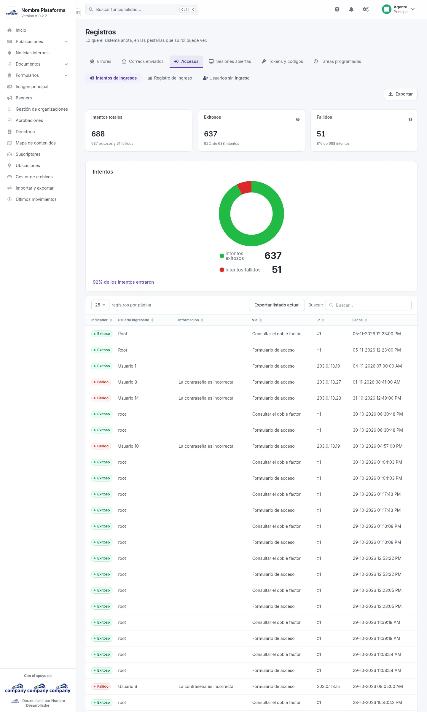
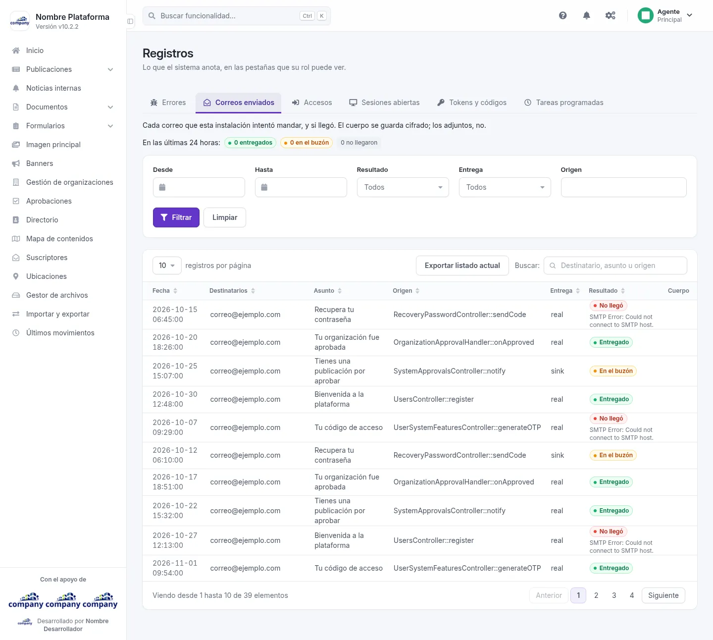
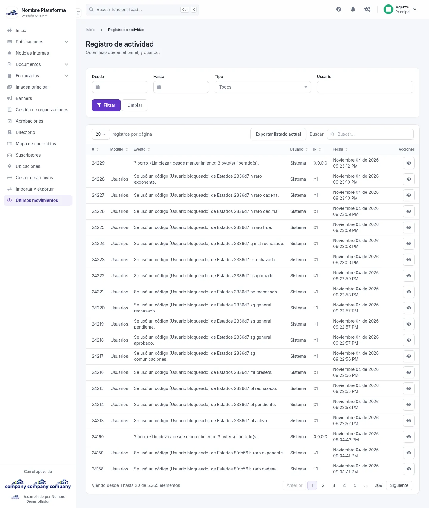

# Registros

Aquí consultas lo que el sistema anota: qué pasó, quién lo hizo y cuándo. Solo ves las partes que tu tipo de cuenta
tiene permitidas.

## Registros
<!-- ve: logs-admin-index -->

Se llega por el botón de engranajes de la barra superior, **«Configuración del sistema» › «Registros y Logs»**,
y la entrada del registro que buscas: **«Errores»**, **«Intentos de ingreso»**, **«Registro de ingresos»**,
**«Usuarios sin ingresos»**, **«Correos enviados»**, **«Tokens y códigos»**, **«Tareas programadas»** o
**«Todos los registros»**. **«Sesiones abiertas»** está en **«Gestión de usuarios»**.

La pantalla se llama **Registros** y trae una fila de pestañas: **Errores**, **Correos enviados**, **Accesos**,
**Sesiones abiertas**, **Tokens y códigos** y **Tareas programadas**. Cada pestaña muestra un tipo de anotación.

### La pestaña Errores

Los errores aparecen agrupados por día, el más reciente primero. Cada anotación muestra la hora, su gravedad, una
referencia, el tipo de error, el mensaje y el archivo donde ocurrió.

Puedes **«Filtrar»** con estos campos y **«Limpiar»** para volver a ver todo:

| Campo | Obligatorio | Para qué |
| --- | --- | --- |
| Referencia | No | Buscar un error por su referencia. |
| Texto (mensaje o archivo) | No | Buscar por una parte del mensaje o del nombre del archivo. |
| Tipo de excepción | No | Quedarte con un tipo de error. |
| Nivel | No | Quedarte con una gravedad. |
| Día | No | Ver solo un día. |
| Otros archivos | No | Cambiar de registro de errores. |

Al final de la lista, **«Más antiguos»** carga la página siguiente.

### Las otras pestañas

Las pestañas **Accesos**, **Sesiones abiertas**, **Tokens y códigos** y **Tareas programadas** existen en la
pantalla, pero este manual todavía no describe su contenido.

## Correos enviados
<!-- ve: system-status-mail-log -->

Es la pestaña **Correos enviados** de **Registros**. Lista los correos que la plataforma envió o intentó enviar.

| Columna | Qué muestra |
| --- | --- |
| Fecha | Cuándo se envió. |
| Destinatarios | A quién iba. |
| Asunto | El asunto del correo. |
| Origen | Qué parte del sistema lo envió. |
| Entrega | Cómo se entregó. |
| Resultado | Si salió bien o falló. |
| Cuerpo | El contenido del correo. |

Con **«Filtrar»** y **«Limpiar»** acotas la lista; **«Exportar listado actual»** descarga lo que estás viendo.

| Campo | Obligatorio | Para qué |
| --- | --- | --- |
| Desde | No | Primera fecha del rango. |
| Hasta | No | Última fecha del rango. |
| Resultado | No | Quedarte con los que salieron bien o con los que fallaron. |
| Entrega | No | Quedarte con una forma de entrega. |
| Origen | No | Buscar por la parte del sistema que lo envió. |

## Registro de actividad
<!-- ve: actions-logs-admin-list -->

Se llega por **«Últimos movimientos»**, en el menú lateral. Responde a «quién hizo qué en el panel, y cuándo».

La tabla muestra: **#**, **Módulo**, **Evento**, **Usuario**, **IP**, **Fecha** y **Acciones**. En cada fila,
**«Ver detalle»** abre el detalle de ese movimiento.

Puedes **«Filtrar»** y **«Limpiar»**, y **«Exportar listado actual»** descarga lo que estás viendo.

| Campo | Obligatorio | Para qué |
| --- | --- | --- |
| Desde | No | Primera fecha del rango. |
| Hasta | No | Última fecha del rango. |
| Tipo | No | Quedarte con un tipo de movimiento. |
| Usuario | No | Ver los movimientos de una persona. |
