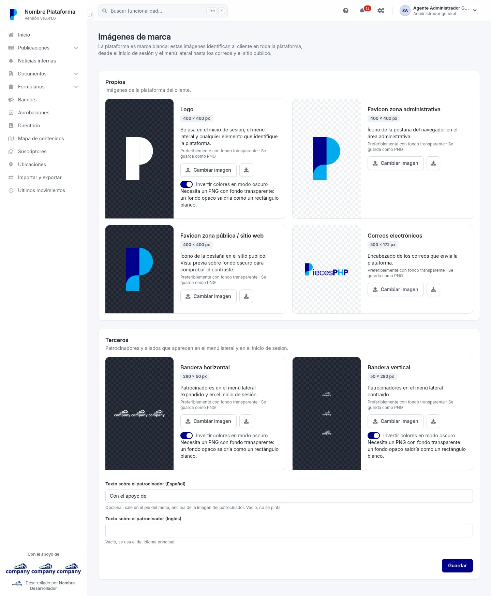
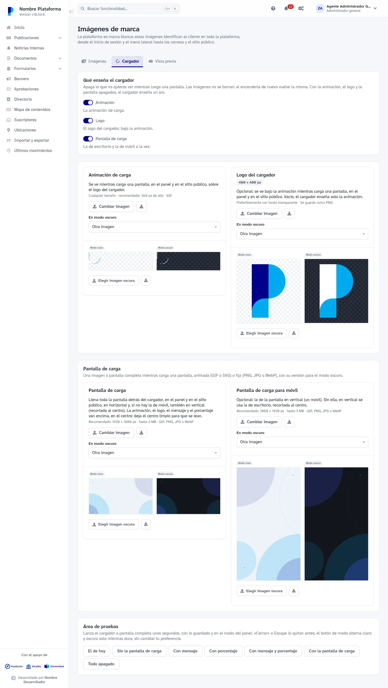
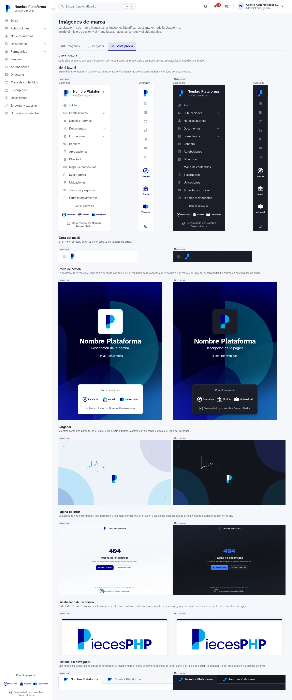
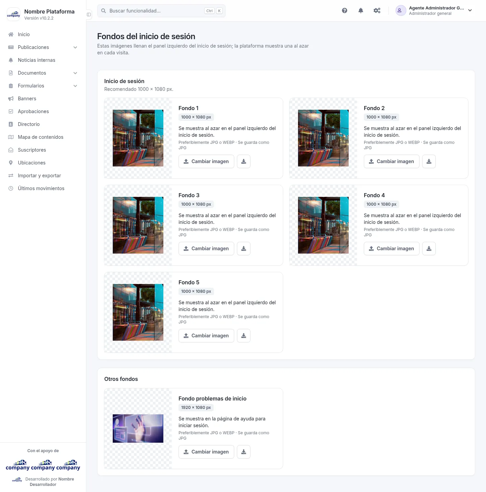
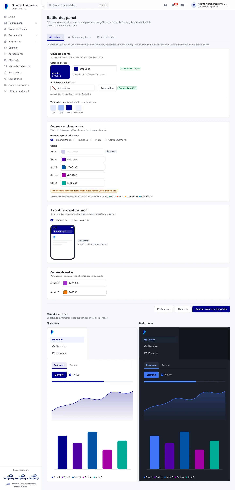
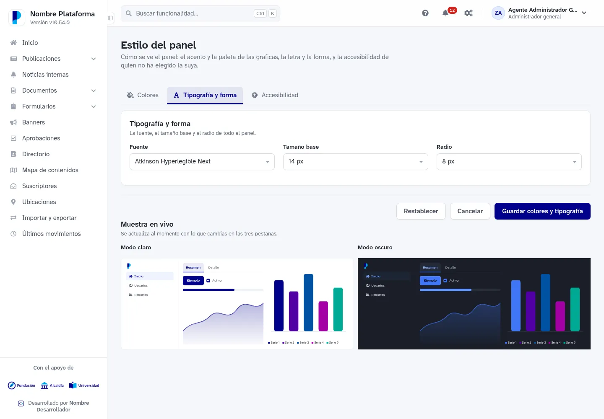
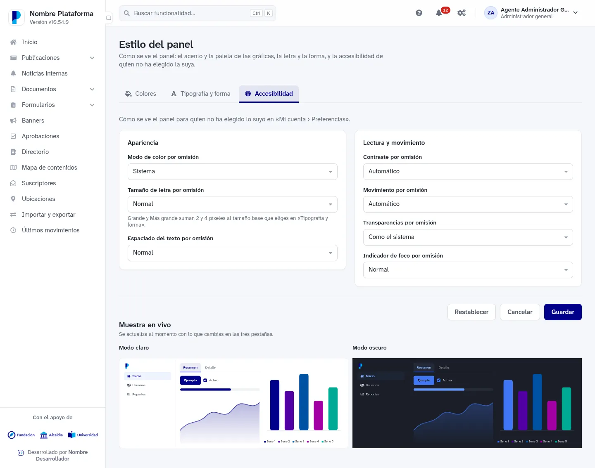
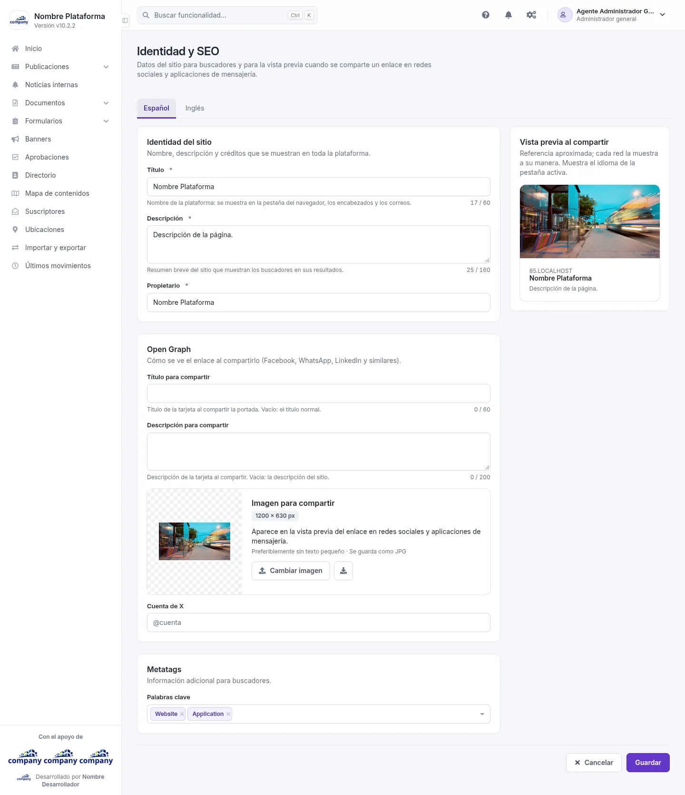
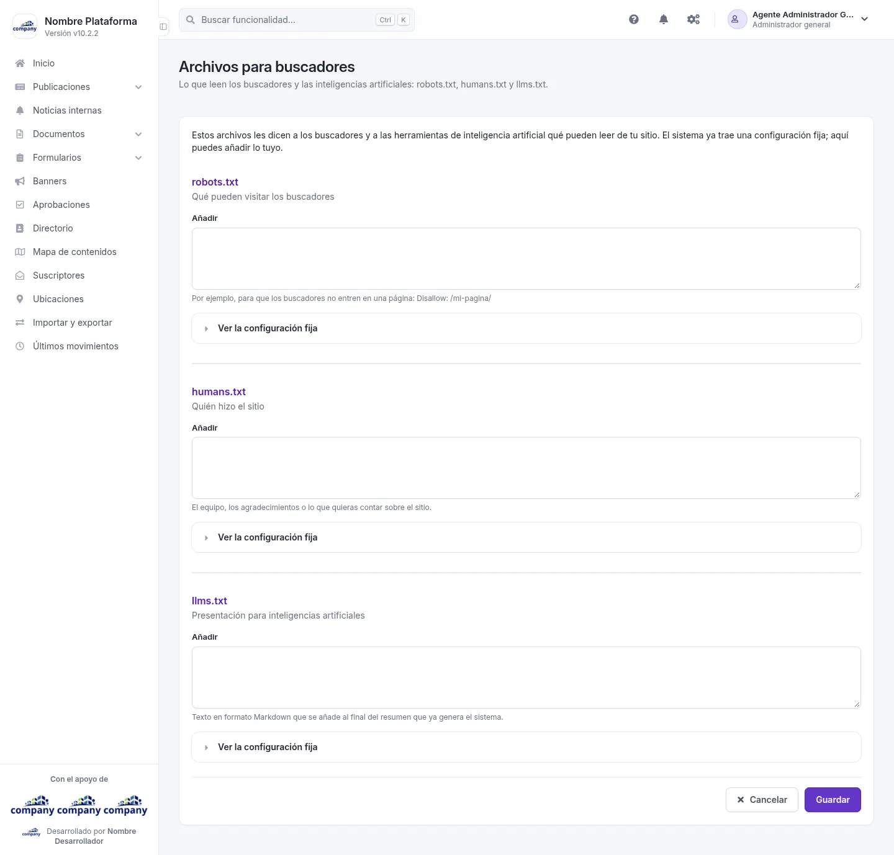

# Configuración de la apariencia

Aquí personalizas cómo se ve y cómo se presenta la plataforma. Se llega por el botón de engranajes de la barra superior, **«Configuración del sistema»**. Imágenes de
marca, Fondos del inicio de sesión y Estilo del panel están en el grupo **«Apariencia»**; Identidad y SEO y
Archivos para buscadores, en **«SEO y Scripts»**.

## Imágenes de marca
<!-- ve: configurations-appearance-brand-images -->

Entra por **«Imágenes de marca»**. La plataforma es de marca blanca: estas imágenes identifican a tu organización en
todo el sistema, desde el inicio de sesión y el menú lateral hasta los correos y el sitio público. La pantalla tiene
tres pestañas: **«Imágenes»**, **«Cargador»** y **«Vista previa»**. La pestaña elegida se queda en la dirección y la
pantalla la recuerda al volver.

Para editar una imagen, púlsala. Además, cada una tiene el botón **«Cambiar imagen»** y un icono para descargarla o verla.
Cada tarjeta dice dónde se usa su imagen y enseña cómo se ve, a su tamaño real: en **«Modo claro»** y, en las que lo
tienen, en **«Modo oscuro»**, una al lado de la otra.

En **«Imágenes»**:

- **Logo**.
- **Favicon zona administrativa** y **Favicon zona pública / sitio web**.
- **Correos electrónicos**.
- En **«Terceros»**: **Bandera horizontal** y **Bandera vertical**, y el texto que va encima de ellas.

| Campo | Obligatorio | Para qué |
| --- | --- | --- |
| Texto sobre el patrocinador | No | Opcional: sale en el pie del menú, encima de la imagen del patrocinador. Hay un campo por cada idioma activo del sitio. En el idioma principal, vacío, no se pinta; en los demás, vacío usa el del idioma principal. |
| En modo oscuro | No | Está en el logo, las dos banderas y en todas las del cargador. **«Igual»** enseña la misma imagen; **«Invertir en blanco»** la vuelve blanca (necesita fondo transparente: un fondo opaco saldría como un rectángulo blanco); **«Otra imagen»** te deja subir una versión para el modo oscuro con **«Elegir imagen oscura»**. Se guarda al cambiarlo. |

Cuando termines con el texto de los patrocinadores, pulsa **«Guardar»**.

### El cargador

En **«Cargador»** está lo que se ve mientras carga una pantalla, en el panel y en el sitio público. Arriba, **«Qué
enseña el cargador»** tiene tres interruptores, encendidos de fábrica: **«Animación»**, **«Logo»** y **«Pantalla de
carga»**. Apagar uno no borra su imagen: al encenderlo vuelve la misma. Con los tres apagados, el cargador enseña un aro
sencillo. Las imágenes de marca no se eliminan: solo se cambian.

- **Animación de carga**: acepta GIF, de cualquier tamaño (se recomiendan 360 px de alto), y se sube tal cual, sin
  recortar. El usuario principal puede subir también un SVG, que se revisa al subirlo. De fábrica es el logo
  dibujándose.
- **Logo del cargador**: una imagen fija debajo de la animación. De fábrica es la «P» del logo (en modo oscuro, en
  blanco y celeste).
- **Pantalla de carga** y **Pantalla de carga para móvil**: una imagen a pantalla completa detrás del cargador,
  animada (GIF; el usuario principal, también SVG) o fija (PNG, JPG o WebP), de hasta 3 MB. La animación, el logo, el
  mensaje y el porcentaje van encima, centrados: deja el centro limpio. Se recomiendan 1920 × 1080 px para escritorio y
  1080 × 1920 px para móvil; si subes la de escritorio y no la de móvil, en un móvil en vertical se usa la tuya
  recortada al centro. De fábrica trae cuatro, animadas, en claro y en oscuro. Con «Reducir movimiento», una pantalla
  animada se queda quieta.

Las imágenes que subes aquí se guardan sin sus datos ocultos (ubicación, cámara), conservando su orientación.

En **«Área de pruebas»**, cada botón lanza el cargador a pantalla completa unos segundos, con lo que tienes guardado y
los interruptores como estén: **«El de hoy»**, **«Sin la pantalla de carga»** (si hay una), **«Con mensaje»**, **«Con
porcentaje»**, **«Con mensaje y porcentaje»**, **«Con la pantalla de carga»** (si está encendida) y **«Todo apagado»**
(el aro). Mientras dura, un botón lo enseña en el otro modo, claro u oscuro, sin cambiar tu preferencia; **«Cerrar»** o
Escape lo quitan antes.

### La vista previa

En **«Vista previa»** ves, con lo guardado, cómo quedan tus imágenes en cada sitio donde se usan, en **«Modo claro»** y
**«Modo oscuro»** lado a lado: el menú lateral expandido y contraído, la barra del móvil, la columna del inicio de
sesión con el recuadro de los apoyos, el cargador, la página de error, el encabezado de un correo y la pestaña del
navegador. Se actualiza al guardar una imagen, sin recargar.

!!! note "Dos simulaciones con matiz"
    El correo no tiene modo oscuro propio (lo decide el programa de correo de quien lo recibe), así que sus dos
    muestras son iguales. La pestaña del navegador es una imitación: la dibuja cada navegador.

## Fondos del inicio de sesión
<!-- ve: configurations-appearance-backgrounds -->

Entra por **«Fondos del inicio de sesión»**. Estas imágenes llenan el panel izquierdo del inicio de sesión; la
plataforma muestra una al azar en cada visita.

Puede haber de **uno a cinco** fondos (**Fondo 1** a **Fondo 5**); las imágenes ocupan las primeras tarjetas y el resto
quedan vacías. En una tarjeta con imagen, púlsala o usa **«Cambiar imagen»** para editarla, el icono para descargarla o
verla y **«Eliminar»** para quitarla (te pide confirmación). Una tarjeta vacía solo tiene **«Cambiar imagen»**: así
agregas un fondo. Siempre queda al menos uno: con un solo fondo, «Eliminar» está desactivado.

Aparte está el **Fondo problemas de inicio**, que se cambia igual y no se puede eliminar.

## Estilo del panel
<!-- ve: configurations-appearance-colors -->

Entra por **«Estilo del panel»**. Es una sola pantalla con tres pestañas: **«Colores»**, **«Tipografía y forma»** y
**«Accesibilidad»**. La pestaña elegida se queda en la dirección, así que puedes guardarla o compartirla, y la
pantalla la recuerda al volver.

Debajo de las pestañas, la **«Muestra en vivo»** enseña el panel en **«Modo claro»** y **«Modo oscuro»** lado a lado
(apiladas en el móvil), y se actualiza al momento con lo que cambias en cualquiera de las tres pestañas, antes de
guardar.

Cada pestaña tiene **«Restablecer»**: te dice qué vuelve a los valores de fábrica, te pide confirmación y lo guarda al
momento. Solo restablece lo de esa pestaña; lo que hubieras cambiado sin guardar en la pantalla se pierde.

!!! note "Colores y tipografía se guardan juntos"
    «Colores» y «Tipografía y forma» son un mismo formulario: el botón **«Guardar colores y tipografía»** guarda lo de
    las dos pestañas. Si dejas cambios sin guardar en la otra, junto al botón lo avisa. «Accesibilidad» se guarda aparte,
    con su propio **«Guardar»**.

### Colores

El color de tu organización se usa solo como acento (botones, selección, enlaces y foco). Los colores complementarios
se usan únicamente en gráficas y datos. Junto a cada color, **«Elegir color»** abre el selector.

| Campo | Obligatorio | Para qué |
| --- | --- | --- |
| Color de acento | No | El color principal de tu organización. Si es demasiado claro u oscuro para leerse, el panel lo ajusta solo, sin cambiar su tono. |
| Acento en modo oscuro | No | El acento cuando el panel está en modo oscuro. Con **«Automático»** lo calcula el panel a partir del acento; debajo se ve el color que sale y su contraste. |
| Personalizados, Análogos, Tríada, Complementario | No | Cómo se generan los colores de las gráficas a partir del acento, o «Personalizados» para elegirlos tú. La serie 1 es siempre el acento. |
| Serie 2, Serie 3, Serie 4, Serie 5 | No | Los colores de las series de las gráficas. |
| Usar acento, Neutro oscuro | No | El color de la barra superior del navegador en los celulares. |
| Acento 2, Acento 3 | No | Colores para realces puntuales: el panel no los usa por su cuenta. |

### Tipografía y forma

| Campo | Obligatorio | Para qué |
| --- | --- | --- |
| Fuente | No | La tipografía del panel: Atkinson Hyperlegible Next (la de fábrica), Red Hat Text, IBM Plex Sans u Onest. |
| Tamaño base | No | El tamaño base del texto. |
| Radio | No | Lo redondeadas que salen las esquinas en todo el panel. |

## Accesibilidad del panel
<!-- ve: configurations-appearance-accessibility -->

Es la pestaña **«Accesibilidad»** de «Estilo del panel» (la dirección antigua de «Accesibilidad» lleva a ella). Aquí
eliges cómo se ve el panel para quien no ha elegido lo suyo en «Mi cuenta» › «Preferencias» (ver «Tu cuenta», «Tus
preferencias»). Tiene las mismas dos tarjetas que las preferencias de cada persona: **Apariencia** y **Lectura y
movimiento**.

| Campo | Obligatorio | Para qué |
| --- | --- | --- |
| Modo de color por omisión | No | En **Apariencia**: **«Claro»**, **«Oscuro»** o **«Sistema»** (el que tenga el dispositivo de cada persona). |
| Tamaño de letra por omisión | No | **«Normal»**, **«Grande»** o **«Más grande»**. Grande y Más grande suman 2 y 4 píxeles al «Tamaño base» de «Tipografía y forma». |
| Espaciado del texto por omisión | No | **«Normal»** o **«Amplio»**: más espacio entre líneas, párrafos, palabras y letras. |
| Contraste por omisión | No | En **Lectura y movimiento**: **«Automático»** (sigue al dispositivo de cada persona) o **«Más contraste»**. |
| Movimiento por omisión | No | **«Automático»** o **«Reducir movimiento»**. |
| Transparencias por omisión | No | **«Como el sistema»** (sigue al dispositivo de cada persona) o **«Reducir»**: fondos opacos en lugar de translúcidos. |
| Indicador de foco por omisión | No | **«Normal»** o **«Reforzado»**: el contorno de lo seleccionado con el teclado, más visible. |

!!! note "Quien ya eligió lo suyo"
    Quien ya eligió algo de esto en sus preferencias sigue con lo suyo aunque cambies esto. Para volver a lo del sitio,
    elige **«Como el sitio»** en ese grupo de sus preferencias.

## Identidad y SEO
<!-- ve: configurations-appearance-seo -->

Entra por **«Identidad y SEO»**. Reúne los datos del sitio que usan los buscadores y la vista previa cuando se comparte
un enlace en redes sociales y aplicaciones de mensajería.

Tiene dos pestañas, **Español** e **Inglés**: los textos se escriben en cada idioma. La imagen para compartir se cambia
con **«Cambiar imagen»**. Al final, **«Cancelar»** o **«Guardar»**.

| Campo | Obligatorio | Para qué |
| --- | --- | --- |
| Título | Sí | Nombre de la plataforma: se muestra en la pestaña del navegador, los encabezados y los correos (hasta 60 caracteres). |
| Descripción | Sí | Resumen breve del sitio que muestran los buscadores en sus resultados (hasta 160 caracteres). |
| Propietario | Sí | Quién es el propietario del sitio. |
| Título para compartir | No | Título de la tarjeta al compartir la portada. Vacío: el título normal (hasta 60 caracteres). |
| Descripción para compartir | No | Descripción de la tarjeta al compartir. Vacía: la descripción del sitio (hasta 200 caracteres). |
| Cuenta de X | No | La cuenta de tu organización en X. |
| Palabras clave | No | Palabras clave del sitio. |

Junto a cada campo, en pequeño, la etiqueta que genera en la página (`<title>`, `og:title`, `meta keywords`…), por si
necesitas buscarla en el código de la página.

- **«Usar el título del sitio»** y **«Usar la descripción del sitio»**: marcadas, el título o la descripción para
  compartir son los del sitio y el campo se apaga mostrándolos; desmarcadas, escribes uno propio.
- **Lo que no se edita aquí, pero se ve**: el **nombre del sitio** (`og:site_name`, el Título), la **dirección** y la
  **URL canónica** de la portada, el **idioma para compartir** (`og:locale`, que se cambia en `config.php`), el **tipo**
  (website en la portada, article en las publicaciones) y el **autor** (`meta author`, el Propietario).

## Archivos para buscadores
<!-- ve: configurations-appearance-site-files -->

Entra por **«Archivos para buscadores»**. Es lo que leen los buscadores y las inteligencias artificiales: los archivos
robots.txt, humans.txt y llms.txt. Para cada uno, **«Ver la configuración fija»** muestra la parte que el sistema ya
trae y no se cambia; en el campo **Añadir** escribes lo tuyo.

| Campo | Obligatorio | Para qué |
| --- | --- | --- |
| Añadir (robots.txt) | No | Por ejemplo, para que los buscadores no entren en una página: `Disallow: /mi-pagina/`. |
| Añadir (humans.txt) | No | El equipo, los agradecimientos o lo que quieras contar sobre el sitio. |
| Añadir (llms.txt) | No | Texto en formato Markdown que se añade al final del resumen que ya genera el sistema. |

Cuando termines, pulsa **«Guardar»**.
