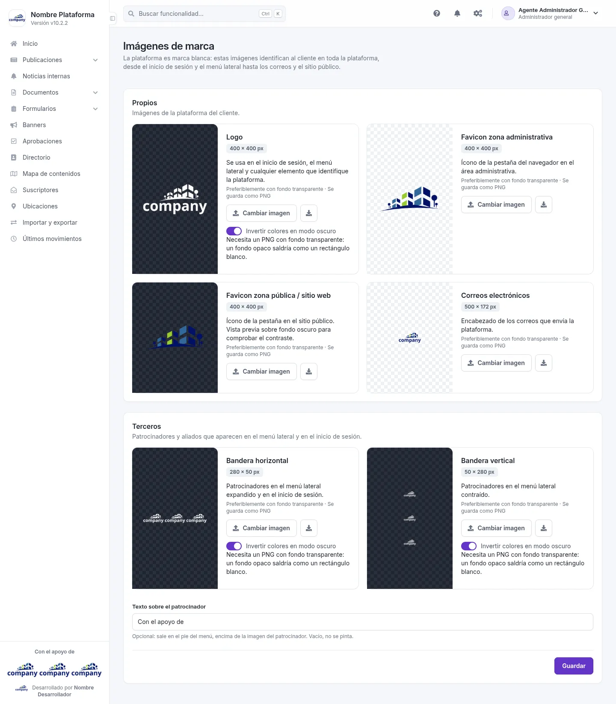
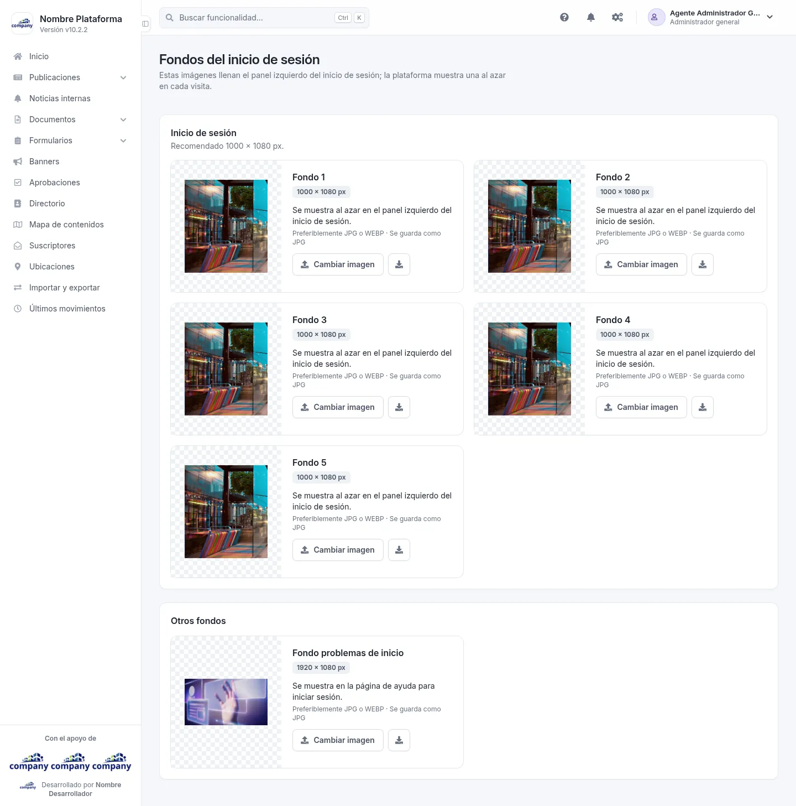
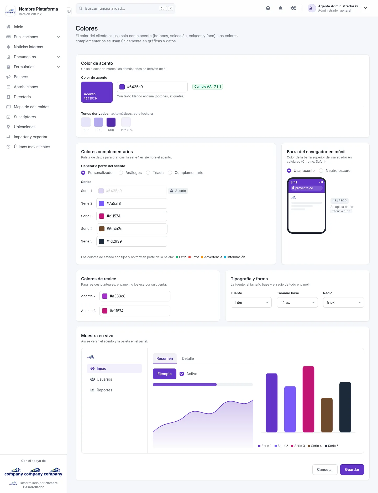
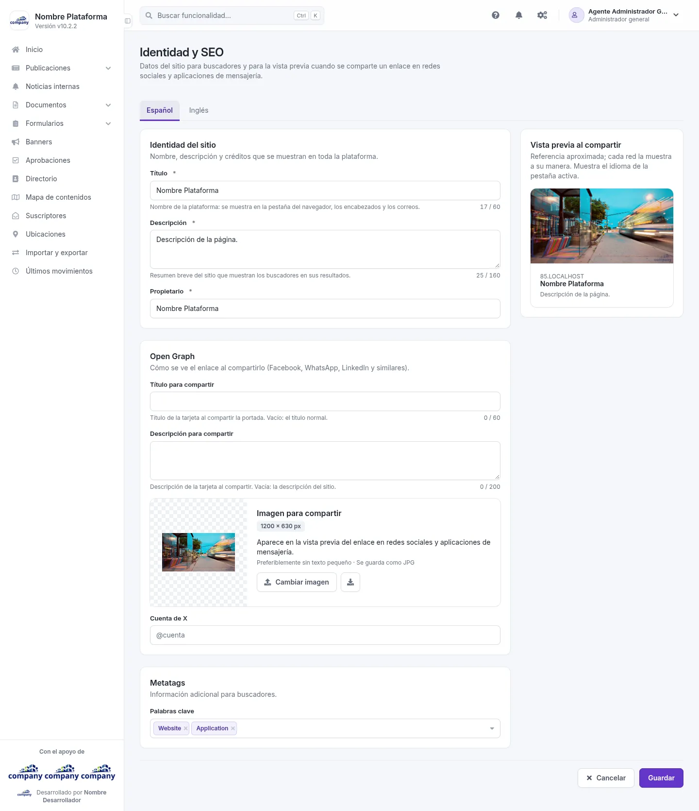
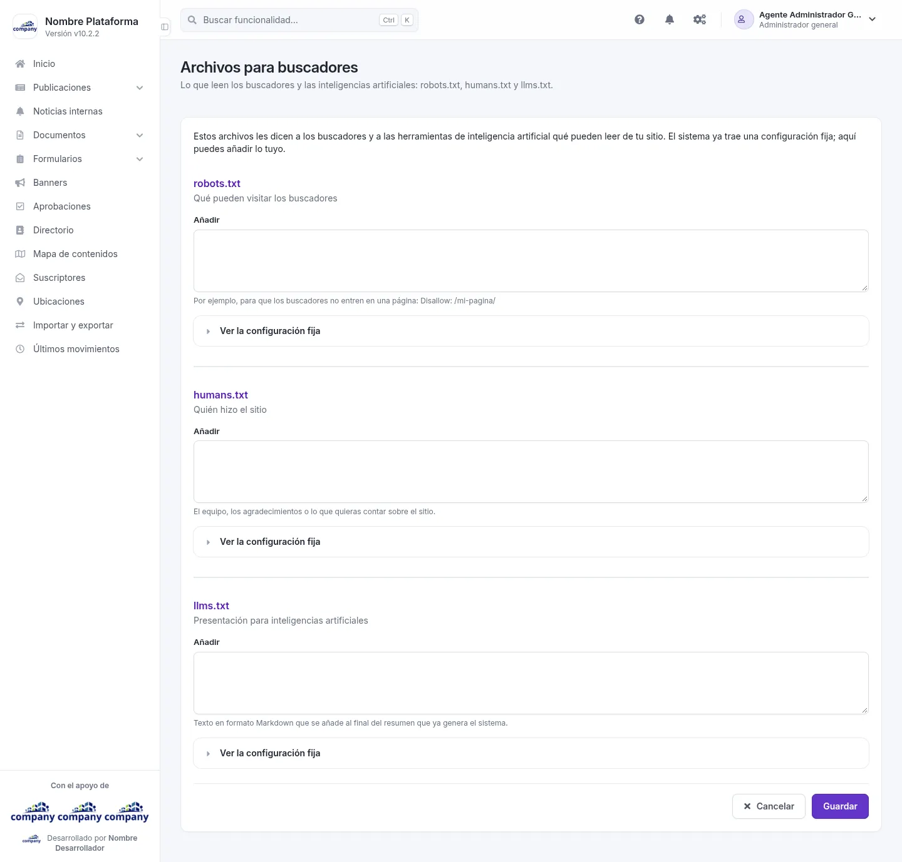

# Configuración de la apariencia

Aquí personalizas cómo se ve y cómo se presenta la plataforma. Se llega por el botón de engranajes de la barra superior, **«Configuración del sistema»**. Imágenes de
marca, Fondos del inicio de sesión y Colores están en el grupo **«Apariencia»**; Identidad y SEO y
Archivos para buscadores, en **«SEO y Scripts»**.

## Imágenes de marca
<!-- ve: configurations-appearance-brand-images -->

Entra por **«Imágenes de marca»**. La plataforma es de marca blanca: estas imágenes identifican a tu organización en
todo el sistema, desde el inicio de sesión y el menú lateral hasta los correos y el sitio público.

Para editar una imagen, púlsala. Además, cada una tiene el botón **«Cambiar imagen»** y un icono para descargarla o verla. Las imágenes son:

- Logo
- Favicon zona administrativa
- Favicon zona pública / sitio web
- Correos electrónicos
- Bandera horizontal
- Bandera vertical

| Campo | Obligatorio | Para qué |
| --- | --- | --- |
| Texto sobre el patrocinador | No | Opcional: sale en el pie del menú, encima de la imagen del patrocinador. Vacío, no se pinta. |
| Invertir colores en modo oscuro | No | Está en algunas imágenes. Necesita un PNG con fondo transparente: un fondo opaco saldría como un rectángulo blanco. |

Cuando termines, pulsa **«Guardar»**.

## Fondos del inicio de sesión
<!-- ve: configurations-appearance-backgrounds -->

Entra por **«Fondos del inicio de sesión»**. Estas imágenes llenan el panel izquierdo del inicio de sesión; la
plataforma muestra una al azar en cada visita.

Hay cinco fondos (**Fondo 1** a **Fondo 5**) y un **Fondo problemas de inicio**. Para editar uno, púlsalo; además
tiene **«Cambiar imagen»** y un icono para descargarlo o verlo.

## Colores
<!-- ve: configurations-appearance-colors -->

Entra por **«Colores»**. El color de tu organización se usa solo como acento (botones, selección, enlaces y foco). Los
colores complementarios se usan únicamente en gráficas y datos.

Junto a cada color, **«Elegir color»** abre el selector. Abajo, la **«Muestra en vivo»** enseña cómo se verán
el acento y la paleta en el panel. Al final, **«Cancelar»** o **«Guardar»**.

| Campo | Obligatorio | Para qué |
| --- | --- | --- |
| Color de acento | No | El color principal de tu organización. |
| Personalizados, Análogos, Tríada, Complementario | No | Cómo se generan los colores de las gráficas a partir del acento, o «Personalizados» para elegirlos tú. La serie 1 es siempre el acento. |
| Serie 2, Serie 3, Serie 4, Serie 5 | No | Los colores de las series de las gráficas. |
| Usar acento, Neutro oscuro | No | El color de la barra superior del navegador en los celulares. |
| Acento 2, Acento 3 | No | Colores para realces puntuales: el panel no los usa por su cuenta. |
| Fuente | No | La tipografía del panel. |
| Tamaño base | No | El tamaño base del texto. |
| Radio | No | Lo redondeadas que salen las esquinas en todo el panel. |

## Identidad y SEO
<!-- ve: configurations-appearance-seo -->

Entra por **«Identidad y SEO»**. Reúne los datos del sitio que usan los buscadores y la vista previa cuando se comparte
un enlace en redes sociales y aplicaciones de mensajería.

Tiene dos pestañas, **Español** e **Inglés**: los textos se escriben en cada idioma. La imagen para compartir se cambia
con **«Cambiar imagen»**. Al final, **«Cancelar»** o **«Guardar»**.

| Campo | Obligatorio | Para qué |
| --- | --- | --- |
| Título | Sí | Nombre de la plataforma: se muestra en la pestaña del navegador, los encabezados y los correos (hasta 60 caracteres). |
| Descripción | Sí | Resumen breve del sitio que muestran los buscadores en sus resultados (hasta 160 caracteres). |
| Propietario | Sí | Quién es el propietario del sitio. |
| Título para compartir | No | Título de la tarjeta al compartir la portada. Vacío: el título normal (hasta 60 caracteres). |
| Descripción para compartir | No | Descripción de la tarjeta al compartir. Vacía: la descripción del sitio (hasta 200 caracteres). |
| Cuenta de X | No | La cuenta de tu organización en X. |
| Palabras clave | No | Palabras clave del sitio. |

## Archivos para buscadores
<!-- ve: configurations-appearance-site-files -->

Entra por **«Archivos para buscadores»**. Es lo que leen los buscadores y las inteligencias artificiales: los archivos
robots.txt, humans.txt y llms.txt. Para cada uno, **«Ver la configuración fija»** muestra la parte que el sistema ya
trae y no se cambia; en el campo **Añadir** escribes lo tuyo.

| Campo | Obligatorio | Para qué |
| --- | --- | --- |
| Añadir (robots.txt) | No | Por ejemplo, para que los buscadores no entren en una página: `Disallow: /mi-pagina/`. |
| Añadir (humans.txt) | No | El equipo, los agradecimientos o lo que quieras contar sobre el sitio. |
| Añadir (llms.txt) | No | Texto en formato Markdown que se añade al final del resumen que ya genera el sistema. |

Cuando termines, pulsa **«Guardar»**.
