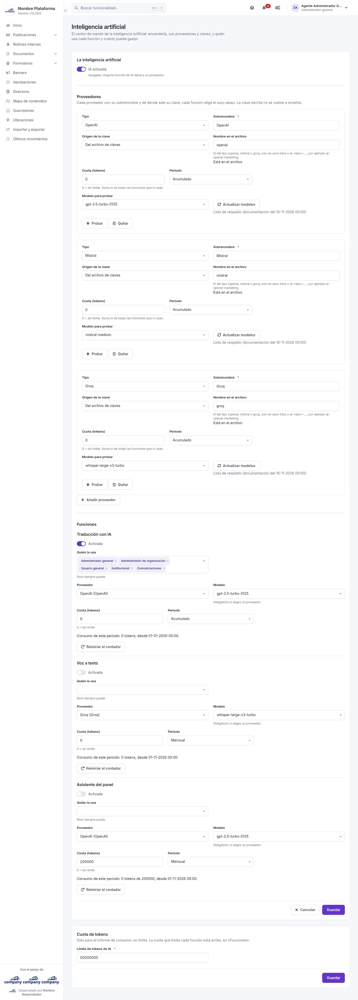
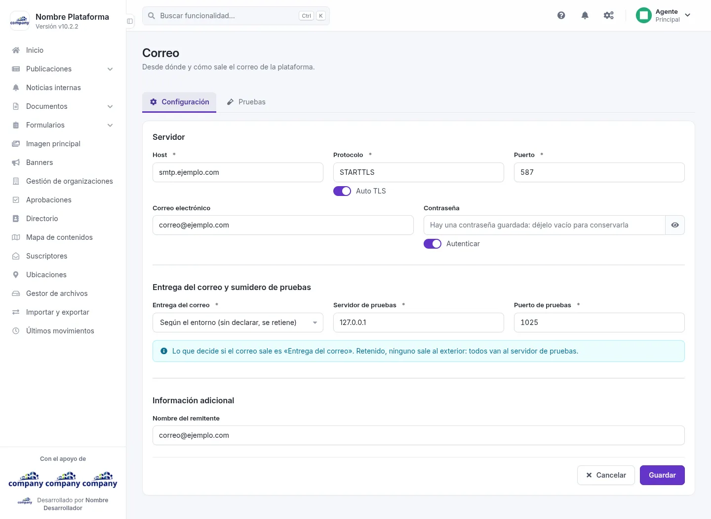
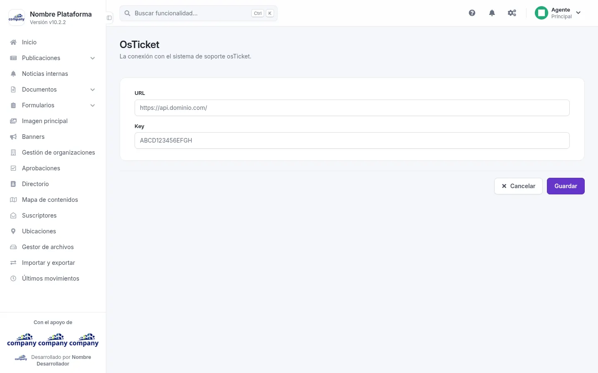
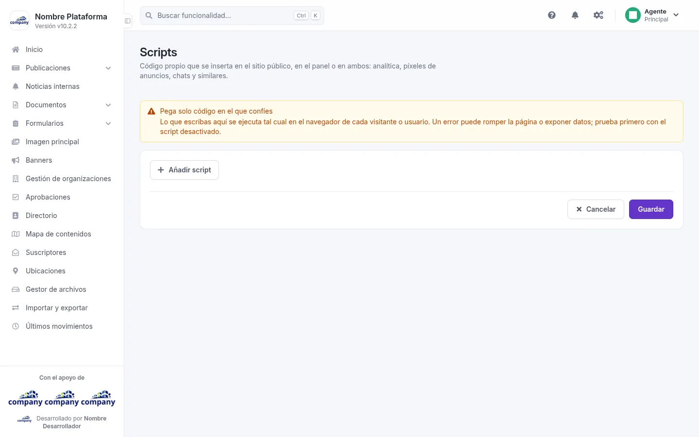
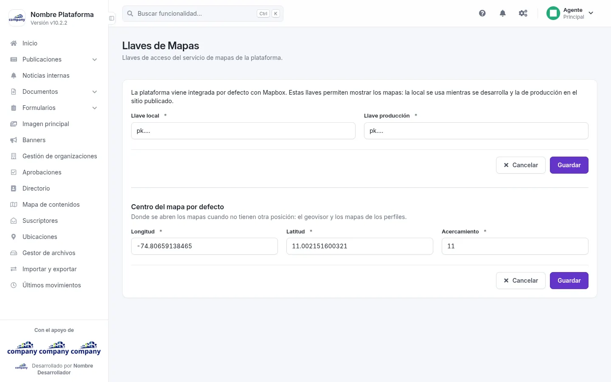

# Configuración de las integraciones

Aquí conectas la plataforma con servicios de fuera. Se llega por el botón de engranajes de la barra superior, **«Configuración del sistema»**: Inteligencia
artificial, Correo, OsTicket y Llaves de Mapas están en el grupo **«Sistema»**, y Scripts, en **«SEO y
Scripts»**. Todas terminan con **«Cancelar»** y **«Guardar»**.

## Inteligencia artificial
<!-- ve: configurations-integrations-ai -->

Entra por **«Inteligencia artificial»**. Es el centro de mando de toda la inteligencia artificial de la plataforma: aquí
la enciendes o la apagas, guardas tus proveedores con sus claves, y decides, función por función, con qué proveedor y
modelo trabaja, quién la usa y cuánto puede gastar.

**La inteligencia artificial**

| Campo | Obligatorio | Para qué |
| --- | --- | --- |
| IA activada | No | El interruptor general. Apagado, ninguna función de inteligencia artificial llama a un proveedor. |

**Proveedores**: cada proveedor de inteligencia artificial que uses, con su sobrenombre y su clave. Cada función elige
el suyo más abajo. Puedes tener varios del mismo proveedor (por ejemplo, dos de OpenAI con claves para fines distintos).

- **OpenAI** y **Mistral**, arriba, son los de la configuración anterior: la traducción los usa. En cada uno eliges su
  **modelo** y escribes su **clave**; si la clave la define el archivo de claves, no se puede cambiar y lo dice; si está
  guardada, **«Quitar la guardada»** la borra. **Groq**, si aparece, solo sirve para pasar voz a texto.
- **«+ Añadir proveedor»** añade uno nuevo. Sin ninguno, la sección dice «Todavía no hay proveedores guardados».

Cada proveedor añadido tiene estos campos:

| Campo | Obligatorio | Para qué |
| --- | --- | --- |
| Tipo | Sí | El proveedor: OpenAI, Mistral, Groq, DeepSeek, xAI, OpenRouter o **Personalizado** (cualquier otro que hable el formato de OpenAI). |
| Sobrenombre | Sí | Cómo lo reconoces en las funciones, por ejemplo «OpenAI principal». No se puede repetir. |
| Clave | No | La clave de acceso. **Una vez guardada no se vuelve a enseñar**: el campo dice «Guardada» con sus cuatro últimos caracteres. Vacío al guardar, conserva la que había; **«Quitar la guardada»** la borra. |
| Dirección base | Sí, en Personalizado | La dirección del servicio: `https://`, o `http://localhost` o `http://127.0.0.1` para un modelo instalado en tu propio equipo. |
| Cabecera de la clave | No, en Personalizado | Si el proveedor pide la clave en otra cabecera. Vacía, se manda como `Authorization: Bearer`. |
| Cuota (tokens) | No | Cuánto puede gastar ese proveedor en cada periodo, **sumando todas las funciones que lo usan**. **0 = sin límite.** |
| Periodo | No | Como en las funciones: Acumulado, Mensual, Cada N días o Cada N meses. |
| Modelo para probar | No | El modelo con el que lo prueba «Probar». |

Debajo de cada uno, su **consumo de este periodo**. **«Probar»** comprueba la clave y el modelo con una llamada mínima,
sin guardar nada ni gastar cuota, y dice al lado si funciona o por qué no (la clave rechazada, un modelo que no existe,
sin conexión). **«Quitar»** lo retira al guardar; si una función lo está usando, no deja guardar y te dice cuál:
elige antes otro proveedor para esa función.

**Funciones**: una sección por cada función de inteligencia artificial que tenga la plataforma (por ejemplo, «Traducción
con IA»), con estos campos:

| Campo | Obligatorio | Para qué |
| --- | --- | --- |
| Activada | No | Enciende o apaga esa función. |
| Quién la usa | No | Qué tipos de usuario pueden usarla. El usuario principal (Root) siempre puede. |
| IA para traducciones | No | Solo en «Traducción con IA»: qué proveedor traduce (OpenAI o Mistral, los de arriba). |
| Proveedor | No | En las demás funciones: cuál de tus proveedores usa. Sin elegir, usa el de «IA para traducciones». |
| Modelo | Sí, si eliges proveedor | El modelo de ese proveedor que usa la función. |
| Cuota (tokens) | No | Cuánto puede gastar la función en cada periodo. **0 = sin límite.** Al llegar a la cuota, la función deja de llamar al proveedor y avisa de que se alcanzó, hasta el periodo siguiente o hasta que reinicies el contador. |
| Periodo | No | Cada cuánto vuelve a contar la cuota: **Acumulado** (no vuelve a contar), **Mensual**, **Cada N días** o **Cada N meses**. Con los dos últimos aparece el campo **«N»**. |

Debajo, la línea **«Consumo de este periodo»** dice lo gastado (y la cuota, si la hay) y desde cuándo. El botón
**«Reiniciar el contador»** pide confirmación y hace que la cuota vuelva a contar desde cero; lo gastado hasta entonces se
conserva para los informes.

**«Asistente del panel»** es la función del asistente de chat del panel: responde preguntas sobre la plataforma (dónde se
hace algo, lo que tienes pendiente) usando solo lo que quien pregunta puede ver. **Viene apagada**, con una cuota de 200.000 tokens
al mes: enciéndela y elige quién la usa antes de que nadie la vea. Por ahora solo existe esta sección: la ventana del chat llega en una versión
próxima.

**Cuota de tokens**, el formulario de abajo, con su propio **«Guardar»**: el **«Límite de tokens de IA»** (obligatorio)
solo sirve para el informe de consumo y **no limita nada**. La cuota que limita es la de cada función.

## Correo
<!-- ve: configurations-integrations-mail -->

Entra por **«Correo»**. Define desde dónde y cómo sale el correo de la plataforma. Tiene dos pestañas:
**Configuración** y **Pruebas**. **«Mostrar contraseña»** deja ver la contraseña que escribes.

!!! warning "Lo que decide si el correo sale"
    Lo que decide si el correo sale es «Entrega del correo». Retenido, ninguno sale al exterior: todos van al servidor
    de pruebas.

| Campo | Obligatorio | Para qué |
| --- | --- | --- |
| Host | Sí | El servidor de correo. |
| Protocolo | Sí | El cifrado de la conexión, elegido en una lista: **STARTTLS** (lo habitual con el puerto 587), **SSL/TLS** (puerto 465) o **Ninguno**. Si ves «(valor actual, no válido)», elige uno de los tres antes de guardar. |
| Auto TLS | No | Casilla para activar el cifrado automático. |
| Puerto | Sí | El puerto del servidor. |
| Correo electrónico | No | La cuenta con la que se envía. |
| Contraseña | No | La contraseña de esa cuenta. |
| Autenticar | No | Casilla para indicar que el servidor pide autenticación. |
| Entrega del correo | Sí | Decide si el correo sale al exterior o se retiene. |
| Servidor de pruebas | Sí | Adónde van los correos cuando están retenidos. |
| Puerto de pruebas | Sí | El puerto del servidor de pruebas. |
| Nombre del remitente | No | El nombre con el que se envían los correos. |
| Destinatario del correo de prueba | No | A quién se envía el correo de prueba. |

Para ver lo que se envió, mira la pestaña **Correos enviados** de **Registros**.

## OsTicket
<!-- ve: configurations-integrations-osticket -->

Entra por **«OsTicket»**. Guarda la conexión con el sistema de soporte osTicket.

| Campo | Obligatorio | Para qué |
| --- | --- | --- |
| URL | No | La dirección del sistema de soporte. |
| Key | No | La clave de acceso a ese sistema. |

## Scripts
<!-- ve: configurations-integrations-scripts -->

Entra por **«Scripts»**. Aquí insertas código propio en el sitio público, en el panel o en ambos: analítica, píxeles de
anuncios, chats y similares. **«Añadir script»** agrega uno nuevo a la lista.

!!! warning "Pega solo código en el que confíes"
    Lo que escribas aquí se ejecuta tal cual en el navegador de cada visitante o usuario. Un error puede romper la
    página o exponer datos; prueba primero con el script desactivado.

## Llaves de Mapas
<!-- ve: helpers-system-generic-content-admin-forms-mapbox-keys -->

Entra por **«Llaves de Mapas»**. Guarda las llaves de acceso del servicio de mapas de la plataforma.

| Campo | Obligatorio | Para qué |
| --- | --- | --- |
| Llave local | Sí | La llave del servicio de mapas para la instalación local. |
| Llave producción | Sí | La llave del servicio de mapas para el sitio en producción. |
| Longitud | Sí | Posición inicial del mapa. |
| Latitud | Sí | Posición inicial del mapa. |
| Acercamiento | Sí | Nivel de acercamiento inicial del mapa. |
