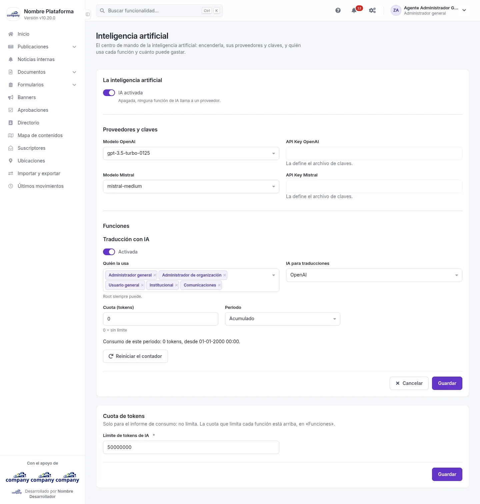
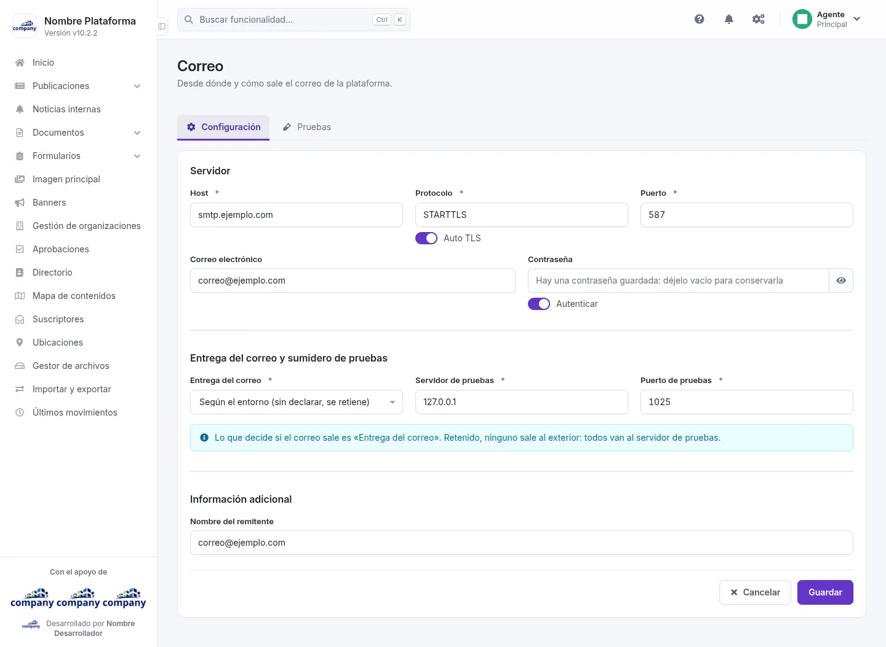
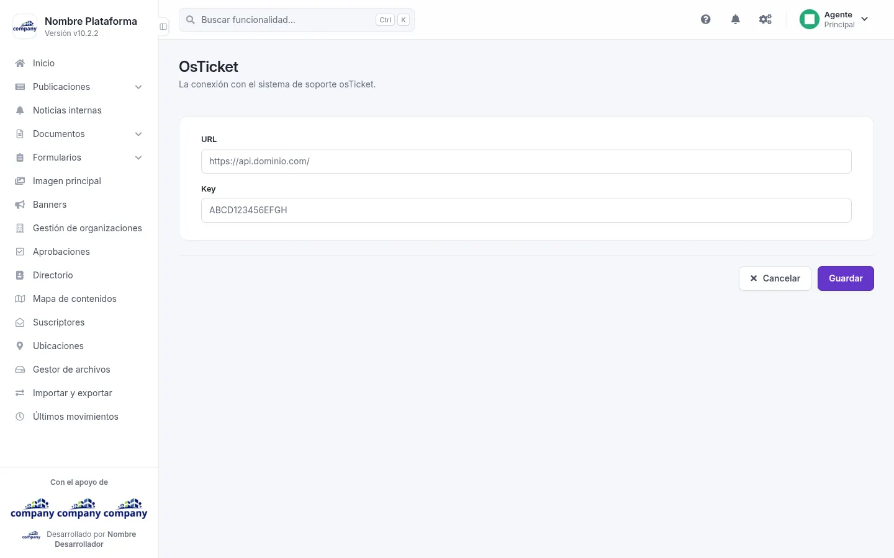
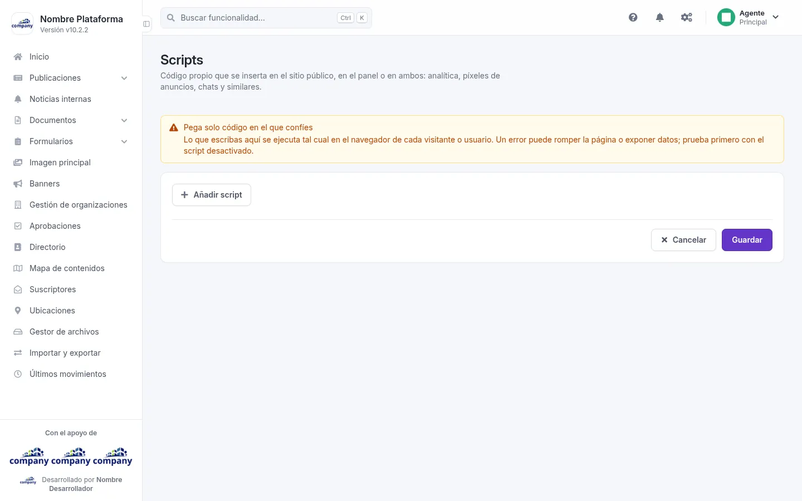
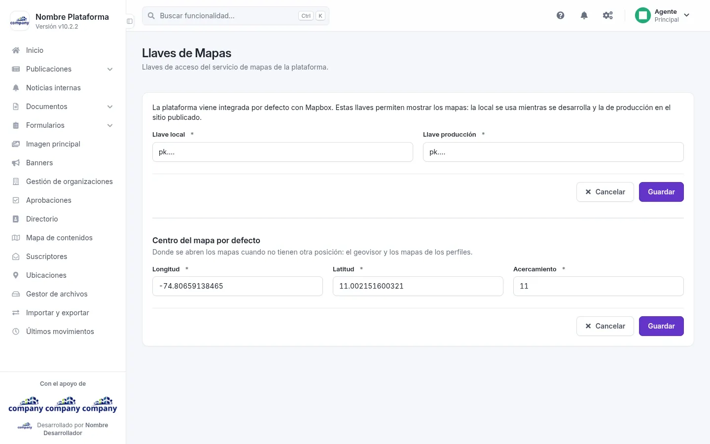

# Configuración de las integraciones

Aquí conectas la plataforma con servicios de fuera. Se llega por el botón de engranajes de la barra superior, **«Configuración del sistema»**: Inteligencia
artificial, Correo, OsTicket y Llaves de Mapas están en el grupo **«Sistema»**, y Scripts, en **«SEO y
Scripts»**. Todas terminan con **«Cancelar»** y **«Guardar»**.

## Inteligencia artificial
<!-- ve: configurations-integrations-ai -->

Entra por **«Inteligencia artificial»**. Define el proveedor, el modelo y las claves que usa la plataforma para las
funciones con inteligencia artificial.

| Campo | Obligatorio | Para qué |
| --- | --- | --- |
| Modelo OpenAI | No | El modelo de OpenAI que se usa. |
| API Key OpenAI | No | La clave de acceso a OpenAI. |
| Modelo Mistral | No | El modelo de Mistral que se usa. |
| API Key Mistral | No | La clave de acceso a Mistral. |
| Activar traducción con IA | No | Enciende o apaga la traducción con inteligencia artificial. |
| IA para traducciones | No | Qué proveedor traduce. |
| Quién puede traducir con IA | No | Qué tipos de usuario pueden usarla. El usuario principal (Root) siempre puede. |
| Límite de tokens de IA | Sí | Solo informativo: la cuota contratada, con la que el informe calcula los tokens restantes. No limita el uso. Se guarda con su propio **«Guardar»**. |

## Correo
<!-- ve: configurations-integrations-mail -->

Entra por **«Correo»**. Define desde dónde y cómo sale el correo de la plataforma. Tiene dos pestañas:
**Configuración** y **Pruebas**. **«Mostrar contraseña»** deja ver la contraseña que escribes.

!!! warning "Lo que decide si el correo sale"
    Lo que decide si el correo sale es «Entrega del correo». Retenido, ninguno sale al exterior: todos van al servidor
    de pruebas.

| Campo | Obligatorio | Para qué |
| --- | --- | --- |
| Host | Sí | El servidor de correo. |
| Protocolo | Sí | El protocolo de conexión. |
| Auto TLS | No | Casilla para activar el cifrado automático. |
| Puerto | Sí | El puerto del servidor. |
| Correo electrónico | No | La cuenta con la que se envía. |
| Contraseña | No | La contraseña de esa cuenta. |
| Autenticar | No | Casilla para indicar que el servidor pide autenticación. |
| Entrega del correo | Sí | Decide si el correo sale al exterior o se retiene. |
| Servidor de pruebas | Sí | Adónde van los correos cuando están retenidos. |
| Puerto de pruebas | Sí | El puerto del servidor de pruebas. |
| Nombre del remitente | No | El nombre con el que se envían los correos. |
| Destinatario del correo de prueba | No | A quién se envía el correo de prueba. |

Para ver lo que se envió, mira la pestaña **Correos enviados** de **Registros**.

## OsTicket
<!-- ve: configurations-integrations-osticket -->

Entra por **«OsTicket»**. Guarda la conexión con el sistema de soporte osTicket.

| Campo | Obligatorio | Para qué |
| --- | --- | --- |
| URL | No | La dirección del sistema de soporte. |
| Key | No | La clave de acceso a ese sistema. |

## Scripts
<!-- ve: configurations-integrations-scripts -->

Entra por **«Scripts»**. Aquí insertas código propio en el sitio público, en el panel o en ambos: analítica, píxeles de
anuncios, chats y similares. **«Añadir script»** agrega uno nuevo a la lista.

!!! warning "Pega solo código en el que confíes"
    Lo que escribas aquí se ejecuta tal cual en el navegador de cada visitante o usuario. Un error puede romper la
    página o exponer datos; prueba primero con el script desactivado.

## Llaves de Mapas
<!-- ve: helpers-system-generic-content-admin-forms-mapbox-keys -->

Entra por **«Llaves de Mapas»**. Guarda las llaves de acceso del servicio de mapas de la plataforma.

| Campo | Obligatorio | Para qué |
| --- | --- | --- |
| Llave local | Sí | La llave del servicio de mapas para la instalación local. |
| Llave producción | Sí | La llave del servicio de mapas para el sitio en producción. |
| Longitud | Sí | Posición inicial del mapa. |
| Latitud | Sí | Posición inicial del mapa. |
| Acercamiento | Sí | Nivel de acercamiento inicial del mapa. |
