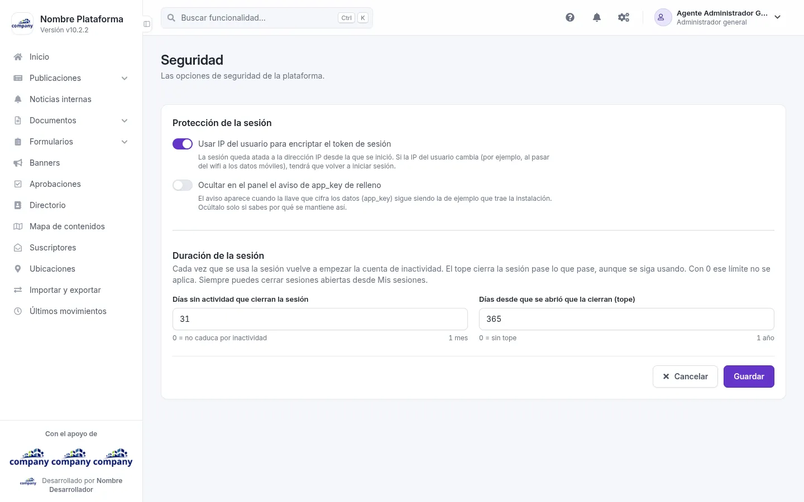
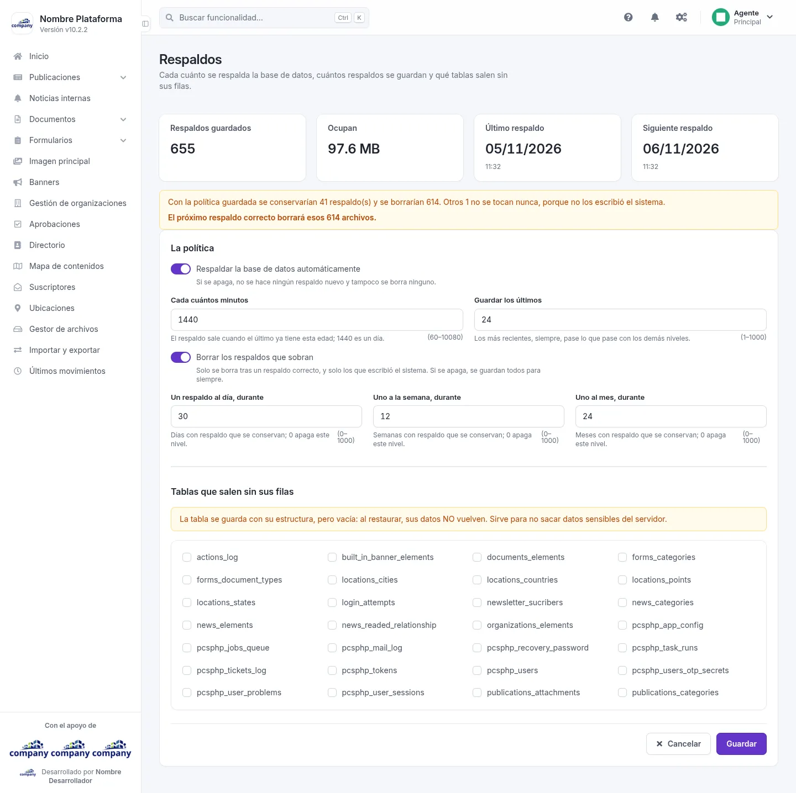
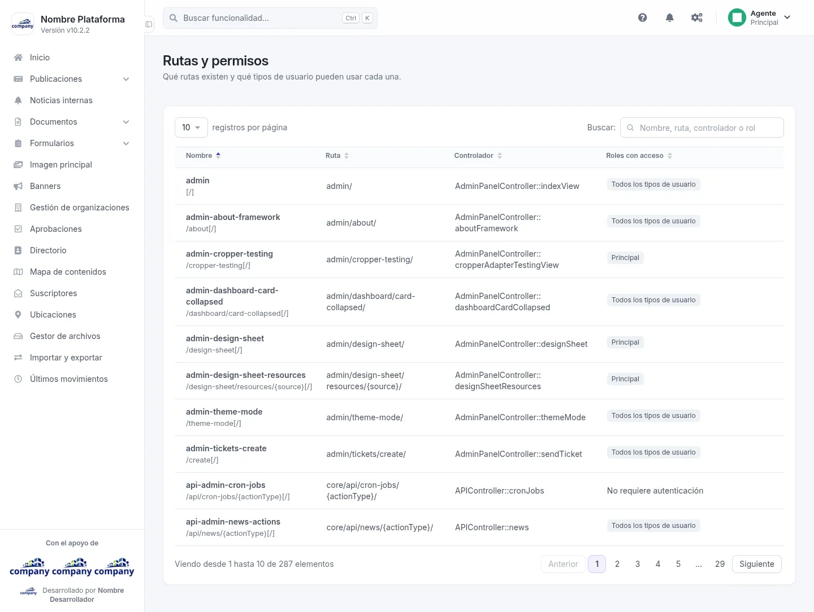

# Configuración del sistema

Opciones de seguridad, respaldos y permisos. Se llega por el botón de engranajes de la barra superior,
**«Configuración del sistema» › «Sistema»**, y la pantalla por su nombre.

## Seguridad
<!-- ve: configurations-system-security -->

Entra por **«Seguridad»**. Reúne las opciones de seguridad de la plataforma. Al final, **«Cancelar»** o
**«Guardar»**.

| Campo | Obligatorio | Para qué |
| --- | --- | --- |
| Usar IP del usuario para encriptar el token de sesión | No | La sesión queda atada a la dirección IP desde la que se inició. Si la IP del usuario cambia (por ejemplo, al pasar del wifi a los datos móviles), tendrá que volver a iniciar sesión. |
| Ocultar en el panel el aviso de app_key de relleno | No | El aviso aparece cuando la llave que cifra los datos (app_key) sigue siendo la de ejemplo que trae la instalación. Ocúltalo solo si sabes por qué se mantiene así. |
| Días sin actividad que cierran la sesión | Sí | Cuántos días sin actividad cierran la sesión. Con 0 no caduca por inactividad. |
| Días desde que se abrió que la cierran (tope) | Sí | Cuántos días, contados desde que se abrió, cierran la sesión. Con 0 no hay tope. |

### Proxies de confianza

Solo la ve root. Hace falta si la plataforma está detrás de un intermediario (un proxy, un balanceador o una red de
distribución como Cloudflare): sin ella, todas las visitas llegan con la IP de ese intermediario, y los frenos del
acceso frenarían a todos a la vez. Con la lista vacía, la plataforma usa la IP de la conexión, como siempre.

La sección enseña qué ve la plataforma ahora: **«IP de la conexión (REMOTE_ADDR)»**, lo que traen las cabeceras
`X-Forwarded-For` y `X-Real-IP` («(no llega)» si no vienen) y la **«IP del visitante que usa la plataforma»**. Si la
conexión llega desde una dirección privada o local con `X-Forwarded-For` y la lista está vacía, un aviso lo dice encima:
hay un intermediario y la plataforma todavía no lo conoce.

Cómo obtener la lista:

- **El intermediario está en la misma máquina** (por ejemplo, un nginx delante de Apache, como suele montar HestiaCP): entra al panel y
  mira la «IP de la conexión»; si es la del servidor o `127.0.0.1`/`::1` y `X-Forwarded-For` trae otra, pulsa
  **«Añadir esta IP a la lista»** y después **«Guardar»**. El botón solo se activa si la petición llega con
  `X-Forwarded-For`; si la IP de la conexión es pública, pide confirmación, porque podría ser la tuya y no la del
  intermediario.
- **Una red de distribución (CDN)**: sus rangos de IP los publica el proveedor (Cloudflare, en `cloudflare.com/ips`).
  Copia cada rango en una línea.
- **Un balanceador o un proxy de tu proveedor**: pídele sus IP o rangos.

Una IP o un rango CIDR por línea. No se admite un rango que abarque todas las direcciones (`0.0.0.0/0`, `::/0`): así
cualquiera podría inventar su IP. Con «Usar IP del usuario para encriptar el token de sesión» activa, cambiar la lista
cierra una vez la sesión de quien entra por los proxies que añadas o quites. Para vaciar la lista, borra todas las líneas
y guarda.

## Respaldos
<!-- ve: configurations-system-backups -->

Entra por **«Respaldos»**. Define cada cuánto se respalda la base de datos, cuántos respaldos se guardan y qué tablas
salen sin sus filas. Al final, **«Cancelar»** o **«Guardar»**.

La pantalla calcula, con la política guardada, cuántos respaldos se conservarían y cuántos se borrarían. Los archivos
que no escribió el sistema no se tocan nunca.

| Campo | Obligatorio | Para qué |
| --- | --- | --- |
| Respaldar la base de datos automáticamente | No | Apagado, no se hace ningún respaldo nuevo y tampoco se borra ninguno. |
| Cada cuántos minutos | Sí | El respaldo sale cuando el último ya tiene esta edad; 1440 es un día (de 60 a 10080). |
| Guardar los últimos | Sí | Los más recientes, siempre (de 1 a 1000). |
| Borrar los respaldos que sobran | No | Solo se borra tras un respaldo correcto, y solo lo que escribió el sistema. Apagado, se guardan todos. |
| Un respaldo al día, durante | Sí | Días con respaldo que se conservan; 0 apaga este nivel. |
| Uno a la semana, durante | Sí | Semanas con respaldo que se conservan; 0 apaga este nivel. |
| Uno al mes, durante | Sí | Meses con respaldo que se conservan; 0 apaga este nivel. |
| Tablas que salen sin sus filas | No | Una casilla por tabla. |

!!! warning "Tablas sin sus filas"
    La tabla se guarda con su estructura, pero vacía: al restaurar, sus datos NO vuelven. Sirve para no sacar datos
    sensibles del servidor.

## Rutas y permisos
<!-- ve: configurations-system-routes -->

Entra por **«Rutas y permisos»**. Es una tabla de consulta: qué rutas existen y qué tipos de usuario pueden usar cada
una. Tiene las columnas **Nombre**, **Ruta**, **Controlador** y **Roles con acceso**.

