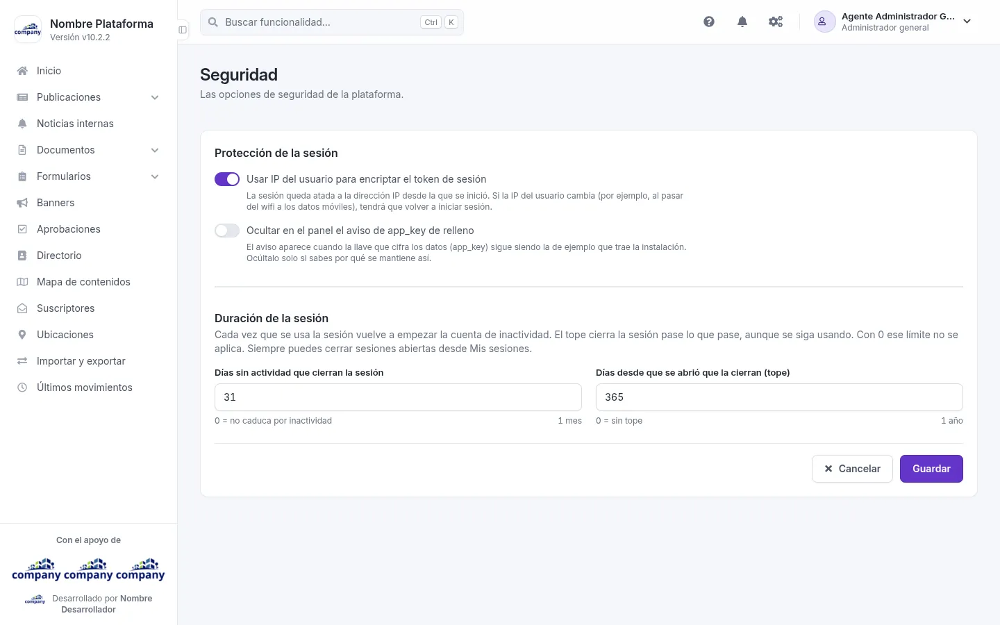
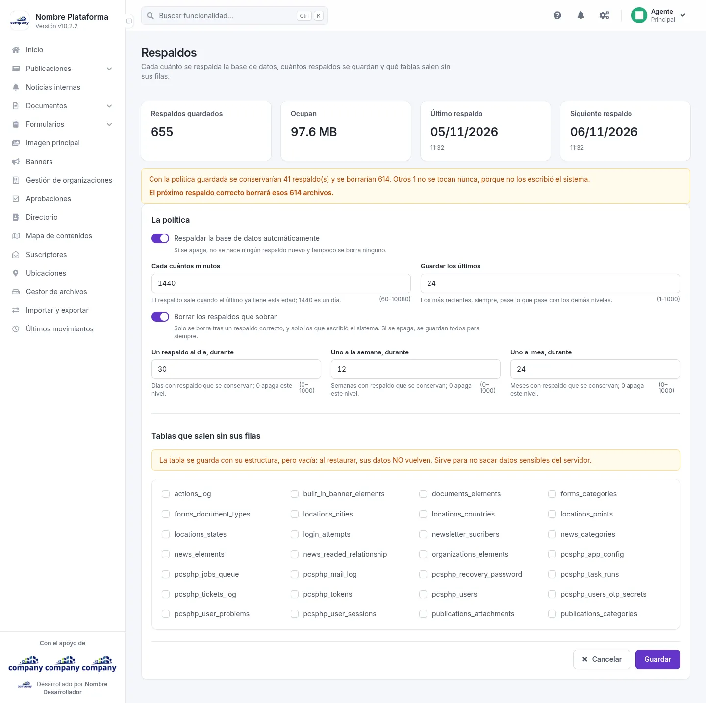
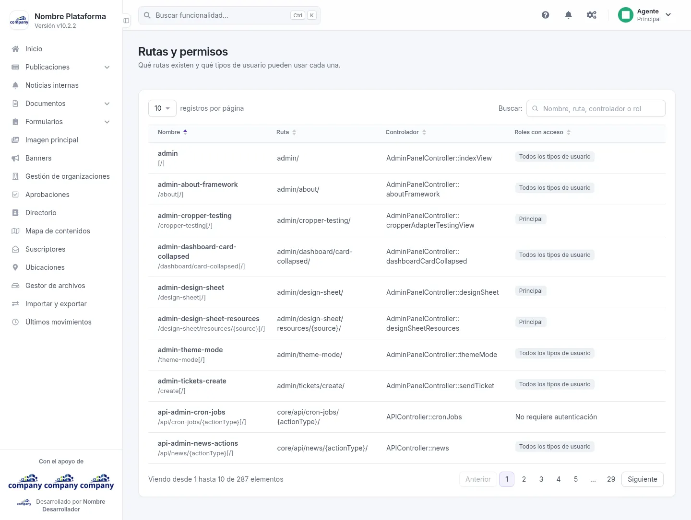

# Configuración del sistema

Opciones de seguridad, respaldos y permisos. Se llega por el botón de engranajes de la barra superior,
**«Configuración del sistema» › «Sistema»**, y la pantalla por su nombre.

## Seguridad

Entra por **«Seguridad»**. Reúne las opciones de seguridad de la plataforma. Al final, **«Cancelar»** o
**«Guardar»**.

| Campo | Obligatorio | Para qué |
| --- | --- | --- |
| Usar IP del usuario para encriptar el token de sesión | No | La sesión queda atada a la dirección IP desde la que se inició. Si la IP del usuario cambia (por ejemplo, al pasar del wifi a los datos móviles), tendrá que volver a iniciar sesión. |
| Ocultar en el panel el aviso de app_key de relleno | No | El aviso aparece cuando la llave que cifra los datos (app_key) sigue siendo la de ejemplo que trae la instalación. Ocúltalo solo si sabes por qué se mantiene así. |
| Días sin actividad que cierran la sesión | Sí | Cuántos días sin actividad cierran la sesión. Con 0 no caduca por inactividad. |
| Días desde que se abrió que la cierran (tope) | Sí | Cuántos días, contados desde que se abrió, cierran la sesión. Con 0 no hay tope. |

## Respaldos

Entra por **«Respaldos»**. Define cada cuánto se respalda la base de datos, cuántos respaldos se guardan y qué tablas
salen sin sus filas. Al final, **«Cancelar»** o **«Guardar»**.

La pantalla calcula, con la política guardada, cuántos respaldos se conservarían y cuántos se borrarían. Los archivos
que no escribió el sistema no se tocan nunca.

| Campo | Obligatorio | Para qué |
| --- | --- | --- |
| Respaldar la base de datos automáticamente | No | Apagado, no se hace ningún respaldo nuevo y tampoco se borra ninguno. |
| Cada cuántos minutos | Sí | El respaldo sale cuando el último ya tiene esta edad; 1440 es un día (de 60 a 10080). |
| Guardar los últimos | Sí | Los más recientes, siempre (de 1 a 1000). |
| Borrar los respaldos que sobran | No | Solo se borra tras un respaldo correcto, y solo lo que escribió el sistema. Apagado, se guardan todos. |
| Un respaldo al día, durante | Sí | Días con respaldo que se conservan; 0 apaga este nivel. |
| Uno a la semana, durante | Sí | Semanas con respaldo que se conservan; 0 apaga este nivel. |
| Uno al mes, durante | Sí | Meses con respaldo que se conservan; 0 apaga este nivel. |
| Tablas que salen sin sus filas | No | Una casilla por tabla. |

!!! warning "Tablas sin sus filas"
    La tabla se guarda con su estructura, pero vacía: al restaurar, sus datos NO vuelven. Sirve para no sacar datos
    sensibles del servidor.

## Rutas y permisos

Entra por **«Rutas y permisos»**. Es una tabla de consulta: qué rutas existen y qué tipos de usuario pueden usar cada
una. Tiene las columnas **Nombre**, **Ruta**, **Controlador** y **Roles con acceso**.

