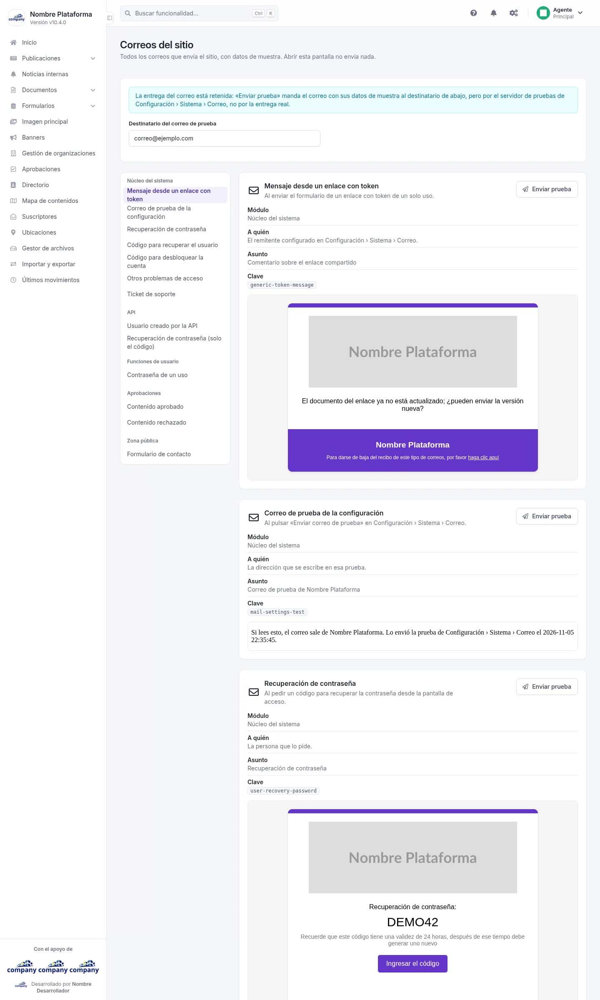

# Correos del sitio

Aquí ves, uno debajo de otro, todos los correos que el sitio puede enviar, cada uno con datos de muestra: cómo llega,
cuándo sale, a quién y con qué asunto. Abrir esta pantalla no envía nada.

## Correos del sitio
<!-- ve: mail-catalog-list -->

Se llega por el botón de engranajes de la barra superior, **«Configuración del sistema» › «Sistema» › «Correos del
sitio»**.

Cada correo tiene su tarjeta, con:

- su **nombre** y **cuándo sale** (por ejemplo, al pedir un código para recuperar la contraseña);
- **a quién** se envía y su **asunto**;
- el **correo tal como llega**, con datos inventados: los nombres, códigos y enlaces de la muestra no son de nadie.

A un lado (en el móvil, arriba, en un desplegable) está la lista de los correos agrupada por módulo: un clic lleva a su
tarjeta, y la lista marca la que estás viendo.

Solo salen los correos de los módulos que están activos en tu instalación. Si tu proyecto añade correos propios y los
declara, aparecen aquí junto a los del sistema.

## Enviar una prueba
<!-- ve: mail-catalog-send-test -->

El botón **«Enviar prueba»** de cada tarjeta manda ese correo, con sus datos de muestra, a la dirección del campo
**«Destinatario del correo de prueba»** (de entrada, la tuya). Solo aparece cuando el correo se retiene: con la
**«Entrega del correo»** en **«Retenido: no sale de esta máquina»**, o en **«Según el entorno»** en una instalación de
desarrollo (en **«Configuración del sistema» › «Sistema» › «Correo»**). Entonces va por el servidor de pruebas
configurado allí, no por la entrega real. El asunto lleva delante **[PRUEBA]** y el envío queda anotado en el registro de
acciones, con el destinatario. Si el correo no se retiene, la pantalla dice por qué no se puede enviar.
