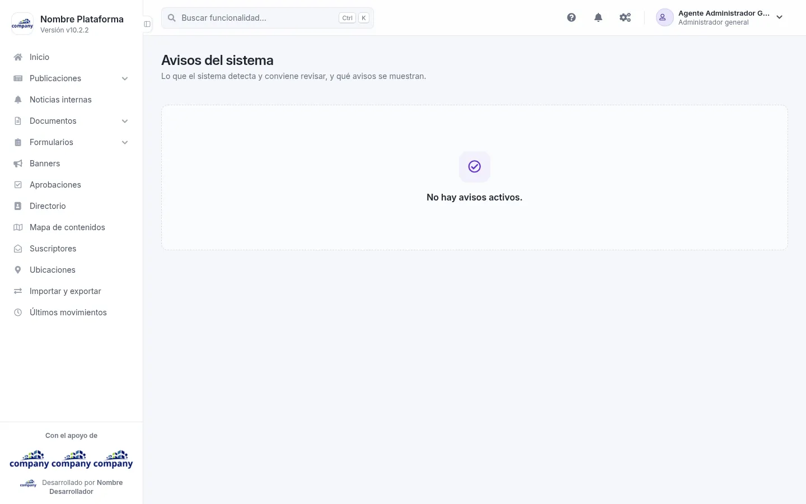
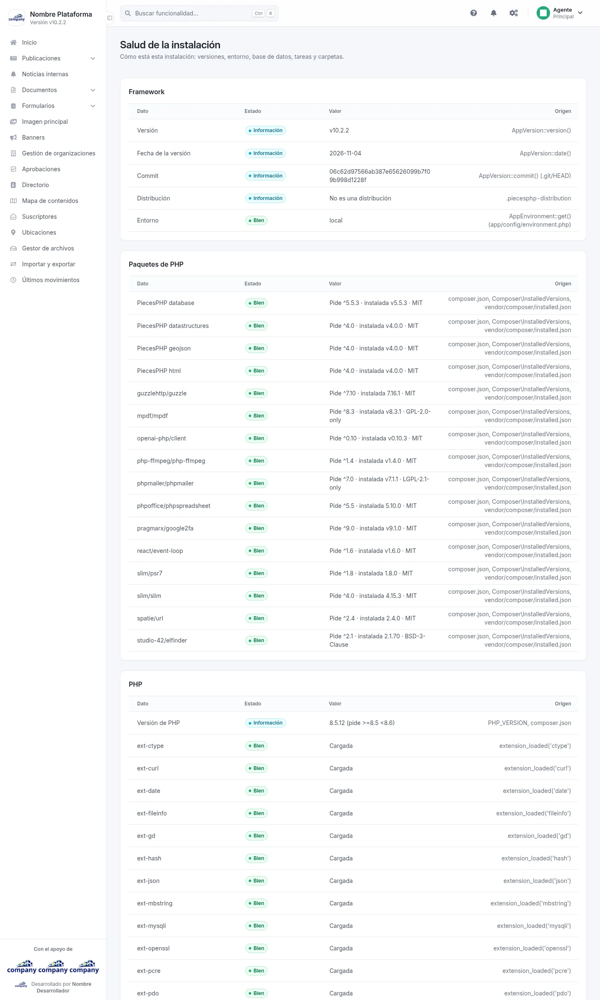
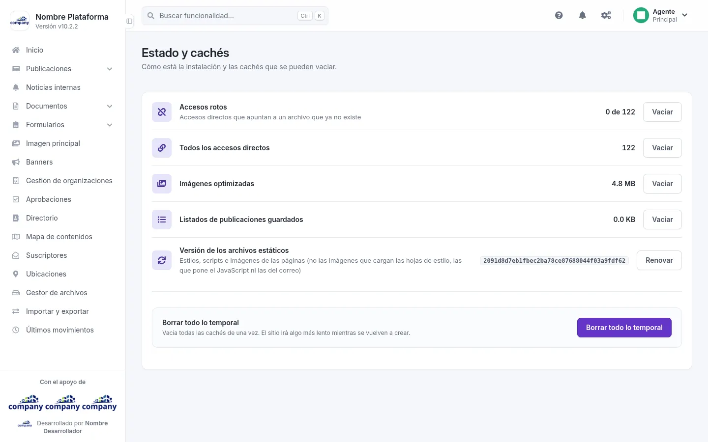
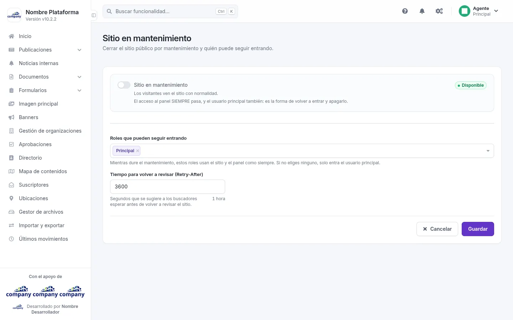

# Estado del sistema

Aquí ves cómo está la instalación y cierras el sitio para hacer mantenimiento. Se llega por el botón de engranajes de la barra superior,
**«Configuración del sistema» › «Sistema»**, y la pantalla por su nombre.

## Avisos del sistema
<!-- ve: system-status-alerts -->

Entra por **«Avisos del sistema»**. Muestra lo que el sistema detecta y conviene revisar, y qué avisos se muestran.

La tabla tiene las columnas **Gravedad**, **Mensaje**, **Estado**, **Cómo arreglarlo** y **Acciones**. Un aviso puede
traer en su fila un botón que lleva a donde se arregla, como **«Correo»**. Si no hay avisos activos, la pantalla lo
dice con **«No hay avisos activos»**, sin la tabla.

## Salud de la instalación
<!-- ve: system-status-health -->

Entra por **«Salud de la instalación»**. Es una pantalla de consulta: cómo está esta instalación en cuanto a versiones,
entorno, base de datos, tareas y carpetas. Cada grupo es una tabla con las columnas **Dato**, **Estado**, **Valor** y
**Origen**.

## Estado y cachés
<!-- ve: system-status-maintenance -->

Entra por **«Estado y cachés»**. Muestra cuánto ocupa cada caché de la instalación, con su botón **«Vaciar»**: los accesos rotos (los que
apuntan a un archivo que ya no existe), todos los accesos directos, las imágenes optimizadas y los
listados de publicaciones guardados. **«Renovar»** cambia la versión de los archivos estáticos (estilos,
scripts e imágenes de las páginas). **«Borrar todo lo temporal»** vacía todas las cachés de una vez: el
sitio irá algo más lento mientras se vuelven a crear.

## Sitio en mantenimiento
<!-- ve: system-status-site-maintenance -->

Entra por **«Sitio en mantenimiento»**. Sirve para cerrar el sitio público por mantenimiento y decidir quién puede
seguir entrando. Al final, **«Cancelar»** o **«Guardar»**.

| Campo | Obligatorio | Para qué |
| --- | --- | --- |
| Sitio en mantenimiento | No | Enciende o apaga el mantenimiento. Apagado, los visitantes ven el sitio con normalidad. |
| Tiempo para volver a revisar (Retry-After) | No | Segundos que se sugiere a los buscadores esperar antes de volver a revisar el sitio. |
| Roles que pueden seguir entrando | No | Mientras dure el mantenimiento, usan el sitio y el panel como siempre. Si no eliges ninguno, solo entra el usuario principal. |

!!! tip "Siempre puedes volver a entrar"
    El acceso al panel SIEMPRE pasa, y el usuario principal también: es la forma de volver a entrar y apagarlo.
