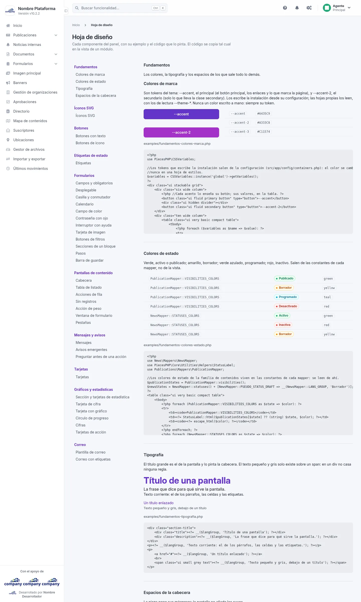

# Hoja de diseño

Es la página donde se ve cada componente del panel (botones, pestañas, colores y demás) con su ejemplo.

Se llega por el botón de engranajes de la barra superior: **«Configuración del sistema» › «Sistema» › «Hoja de diseño»**. Las migas de la pantalla
son **Inicio › Hoja de diseño**.
